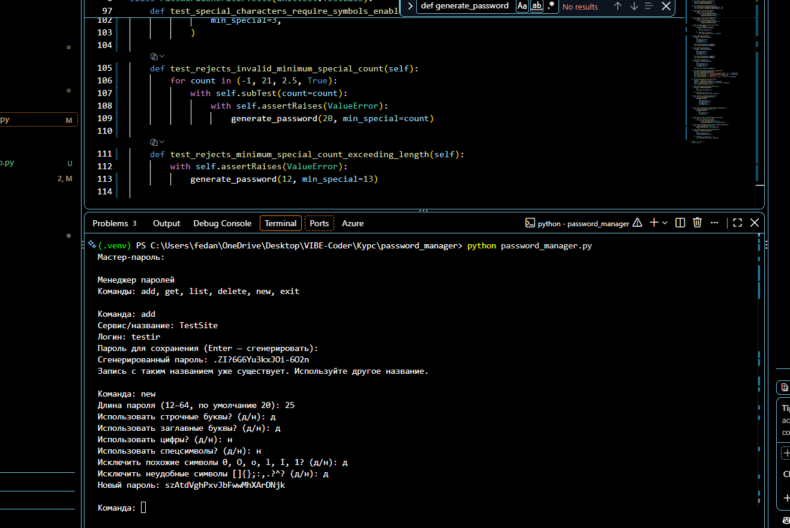
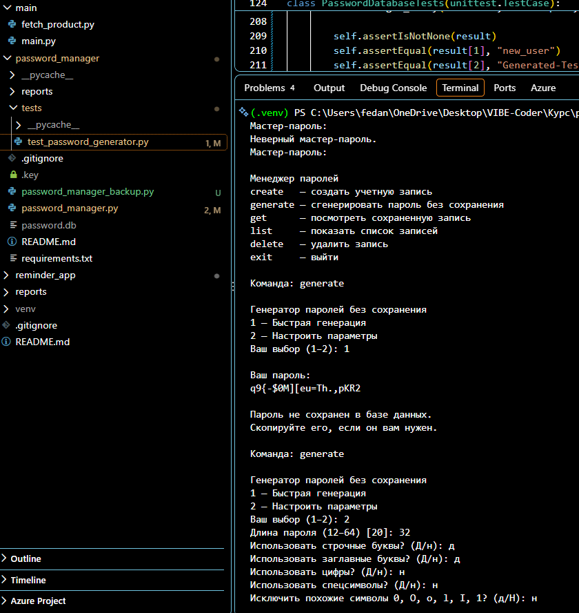
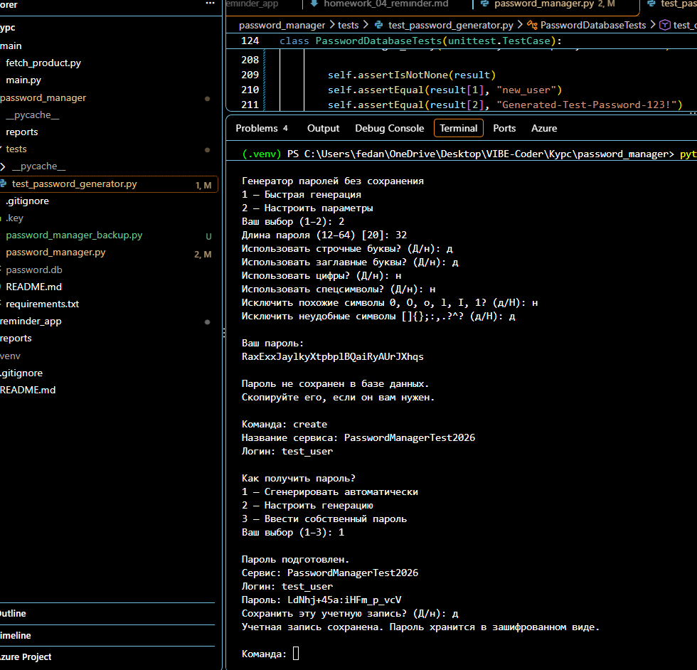
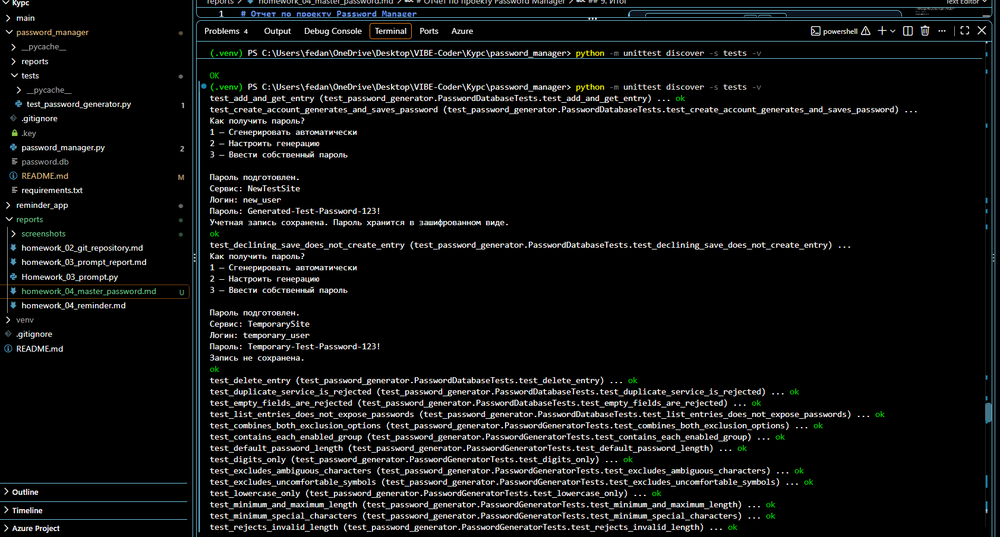
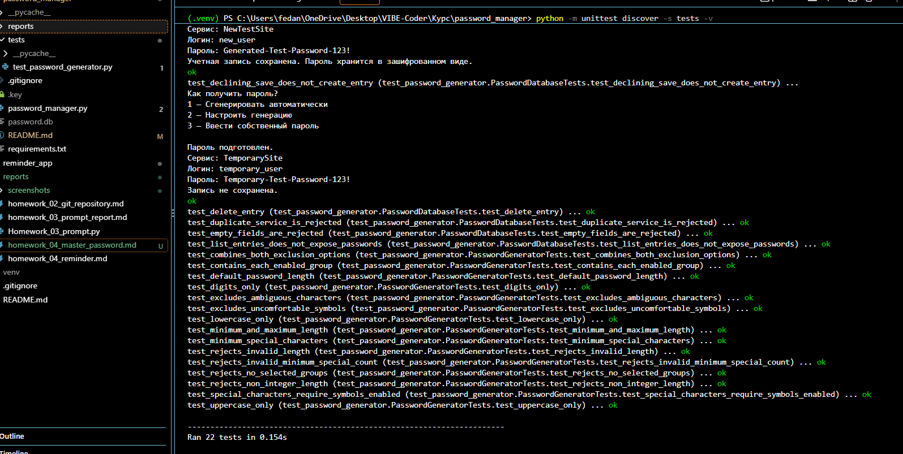

# Отчет по проекту Password Manager

**Курс:** вайб-кодинг  
**Проект:** локальный менеджер паролей на Python  
**Тип приложения:** консольное приложение (CLI)  
**Статус:** основные сценарии реализованы, автоматические тесты пройдены

## 1. Цель проекта

Цель проекта — создать консольное приложение на Python, которое позволяет генерировать пароли, создавать учетные записи для различных сервисов и хранить пароли в зашифрованном виде в локальной базе данных.

В процессе разработки решались не только задачи программирования отдельных функций, но и задачи проектирования пользовательских сценариев, проверки корректности данных, организации хранения, автоматического тестирования и подготовки проекта к публикации в GitHub.

Проект стал практической работой, объединяющей несколько важных направлений разработки:

- работа с функциями и обработкой пользовательского ввода;
- генерация случайных паролей;
- взаимодействие с SQLite;
- шифрование данных;
- хеширование мастер-пароля;
- организация модульного кода;
- написание автоматических тестов;
- работа с Git и сохранение истории изменений.

## 2. Первая версия проекта

### 2.1. Основная идея

Первая версия представляла собой базовый консольный менеджер паролей. В ней уже были реализованы основные операции с учетными записями и отдельная генерация паролей.

Пользователь мог добавлять запись, указывать сервис и логин, получать сохраненную запись, просматривать список учетных записей и удалять ненужные данные.

Генератор паролей был доступен и как отдельная функция. Это позволяло использовать приложение не только для хранения, но и для получения новых паролей.

### 2.2. Основные функции первой версии

**Работа с учетными записями**

Приложение сохраняло данные, связанные с сервисом и логином, и предоставляло команды для последующего получения и удаления записей.

**Генерация паролей**

Пользователь мог получить случайный пароль. Генератор стал отдельной функциональной частью проекта, которую впоследствии можно было развивать независимо от базы данных.

**Локальное хранение**

Для хранения записей использовалась SQLite — встроенная реляционная база данных, не требующая отдельного сервера.

**Шифрование сохраненных паролей**

В проекте использовался Fernet из библиотеки `cryptography`. Это позволило отделить механизм хранения записи от механизма защиты самого пароля.

### 2.3. Ограничения первой версии

По мере использования стало понятно, что наличие отдельных команд еще не гарантирует удобный пользовательский сценарий.

Основные направления улучшения:

- объединить ввод данных учетной записи и выбор способа получения пароля;
- дать пользователю выбор между автоматической генерацией, настройкой параметров и собственным паролем;
- отделить генерацию без сохранения от создания учетной записи;
- проверить граничные случаи генератора;
- добавить автоматические тесты для генерации и операций с базой данных;
- сделать сообщения приложения более последовательными и понятными.

Первая версия стала основой для дальнейшего развития: вместо создания нового приложения проект был расширен и переработан.



## 3. Вторая версия проекта

### 3.1. Переработка пользовательского сценария

Во второй версии основной сценарий создания учетной записи был объединен в одну последовательность.

Пользователь указывает название сервиса и логин, затем выбирает способ получения пароля:

1. автоматическая генерация;
2. генерация с настройкой параметров;
3. ручной ввод собственного пароля.

После подготовки пароля приложение показывает данные учетной записи и спрашивает, нужно ли сохранить запись. Если пользователь отказывается, учетная запись не сохраняется.

Такое решение делает поведение приложения предсказуемее: создание учетной записи и получение отдельного пароля больше не смешиваются в одном сценарии.

### 3.2. Генератор паролей

Генератор получил настройки, позволяющие выбирать:

- длину пароля;
- строчные буквы;
- заглавные буквы;
- цифры;
- специальные символы;
- исключение похожих символов;
- исключение отдельных неудобных символов;
- минимальное количество специальных символов при соответствующих настройках.

Проверки ограничивают недопустимые параметры: например, некорректную длину, отсутствие выбранных групп символов и несовместимые требования к специальным символам.

Это важно, поскольку генератор должен не просто выдавать случайную строку, а выполнять заданные пользователем условия.



### 3.3. Генерация без сохранения

Вторая версия содержит отдельную команду `generate`.

Она позволяет быстро получить пароль или настроить параметры генерации. Результат выводится пользователю, но не добавляется в базу данных.

Такое разделение позволяет использовать генератор независимо от системы хранения учетных записей.

### 3.4. Работа с базой данных

В проекте реализованы операции:

- создание записи;
- получение записи по названию сервиса;
- вывод списка сервисов и логинов;
- удаление выбранной записи;
- проверка обязательных полей;
- предотвращение повторного создания записи с уже используемым названием сервиса.

При выводе списка пароли не раскрываются. Для получения конкретной записи предусмотрена отдельная команда.

### 3.5. Шифрование и мастер-пароль

В проекте используются два различных механизма защиты:

- **Fernet** — для шифрования и последующей расшифровки сохраненных паролей;
- **хеширование мастер-пароля** — для проверки введенного пользователем секрета без хранения его в открытом виде.

Ключ шифрования хранится отдельно от базы данных. Файл ключа и база исключены из Git, чтобы не публиковать локальные секреты вместе с исходным кодом.

Это важное архитектурное решение, однако оно не делает приложение автоматически безопасным для хранения критически важных данных. Необходимо учитывать защиту компьютера, файлов, резервных копий и разблокированного приложения.



### 3.6. Организация кода

Вторая версия объединяет функции генерации, работы с базой данных, шифрования и взаимодействия с пользователем в одном основном файле `password_manager.py`.

Это упрощает запуск учебного проекта, хотя по мере роста приложения код можно разделить на модули: генератор, слой хранения, безопасность и интерфейс.

## 4. Автоматическое тестирование

### 4.1. Зачем понадобились тесты

Ручная проверка позволяет увидеть, как приложение ведет себя при обычном использовании. Однако она не гарантирует, что все граничные случаи работают корректно.

Автоматические тесты позволяют повторно проверять функции после изменений и обнаруживать регрессии — ситуации, когда новая доработка ломает ранее работавшее поведение.

Для тестирования используется стандартная библиотека Python `unittest`.

### 4.2. Проверка генератора

В наборе тестов проверяются:

- длина пароля по умолчанию;
- минимальная и максимальная допустимая длина;
- состав символов в зависимости от выбранных групп;
- исключение похожих символов;
- исключение неудобных символов;
- минимальное количество специальных символов;
- сочетание нескольких ограничений;
- обработка недопустимых значений;
- отказ от генерации при отсутствии разрешенных групп символов.

### 4.3. Проверка базы данных

Тесты операций с данными проверяют:

- добавление и получение записи;
- вывод списка без раскрытия паролей;
- отклонение повторного сервиса;
- удаление записи;
- отказ от сохранения при пустых полях;
- создание учетной записи с автоматически сгенерированным паролем;
- отсутствие записи, если пользователь отказался от сохранения.

### 4.4. Результат

Команда запуска тестов:

```powershell
python -m unittest discover -s tests -v
```





Результат последнего проверенного запуска:

**22 теста выполнены успешно (`OK`).**

Из них 15 относятся к генератору и 7 — к операциям с базой данных и сценарию создания учетной записи.

Это подтверждает корректность проверенных сценариев, но не является исчерпывающим аудитом безопасности.

## 5. Ручная проверка приложения

После автоматических тестов были выполнены проверки через реальный интерфейс приложения.

| Проверка                                  | Результат                                   |
| ----------------------------------------- | ------------------------------------------- |
| Быстрая генерация пароля                  | Успешно                                     |
| Генерация с пользовательскими параметрами | Успешно                                     |
| Создание учетной записи                   | Успешно                                     |
| Сохранение записи                         | Успешно                                     |
| Просмотр списка                           | Успешно                                     |
| Получение сохраненной записи              | Успешно                                     |
| Поиск несуществующей записи               | Корректное сообщение об отсутствии записи   |
| Удаление тестовой записи                  | Успешно                                     |
| Сохранение ранее существовавшей записи    | Подтверждено после удаления тестовой записи |

Для проверки создания и удаления была использована тестовая учетная запись `PasswordManagerTest2026`. После проверки она была удалена. Существующая запись `TestSite` осталась в базе.

## 6. Git и сохранение истории проекта

Работа велась в существующем репозитории курса, без создания отдельного вложенного Git-репозитория для менеджера паролей.

В ходе завершения работы:

1. Проверен статус измененных файлов.
2. Убедились, что база данных и ключ шифрования игнорируются Git.
3. Проверены изменения командой `git diff --check`.
4. В коммит включены основной файл приложения и файл тестов.
5. Создан локальный коммит `d453ee2` с сообщением `Improve password manager and add tests`.
6. Команда `git status` подтвердила чистое рабочее дерево.

Изменения были зафиксированы локально. Отправка этого коммита на GitHub на момент подготовки отчета не выполнялась.

## 7. Что было изучено в ходе работы

Проект помог на практике освоить следующие темы.

**Python**

Организация функций, работа с параметрами, условиями, исключениями, строками и пользовательским вводом.

**Работа с данными**

Подключение к SQLite, выполнение SQL-запросов, создание таблиц и выполнение операций над записями.

**Основы защиты информации**

Различие между хешированием мастер-пароля и обратимым шифрованием сохраненных паролей. Разделение базы данных и ключа шифрования.

**Тестирование**

Создание тестов на корректные и ошибочные сценарии, изоляция тестовой базы данных, подмена пользовательского ввода и проверка результата выполнения функции.

**Git**

Проверка состояния репозитория, анализ diff, подготовка файлов к коммиту, создание коммита и проверка чистоты рабочего дерева.

**Разработка через итерации**

Вместо попытки сразу получить законченный продукт работа велась по этапам: базовая версия, улучшение сценариев, тестирование, ручная проверка и фиксация результата.

## 8. Как можно развить проект

### Этап 1. Улучшение интерфейса

- оформить сообщения и меню единообразно;
- добавить понятные статусы операций;
- улучшить обработку неверного ввода;
- маскировать пароль при отображении;
- добавить отдельное действие для раскрытия пароля;
- предусмотреть копирование пароля в буфер обмена.

### Этап 2. Расширение возможностей хранения

- редактирование существующей записи;
- поиск по сервису;
- категории и заметки;
- экспорт и импорт с шифрованием;
- создание и проверка резервных копий;
- подтверждение потенциально опасных операций.

### Этап 3. Усиление тестирования

- тесты успешной и неуспешной аутентификации;
- тесты ошибок шифрования и отсутствующего ключа;
- проверки поврежденной базы данных;
- дополнительные граничные сценарии;
- тесты командного интерфейса;
- автоматический запуск тестов при каждом изменении кода.

### Этап 4. Улучшение архитектуры

По мере роста проекта можно разделить код на независимые модули:

- `generator.py` — генерация паролей;
- `storage.py` — работа с SQLite;
- `security.py` — шифрование и проверка мастер-пароля;
- `cli.py` — меню и взаимодействие с пользователем.

Это упростит сопровождение, тестирование и дальнейшее расширение.

### Этап 5. Развитие пользовательского приложения

Возможные направления:

- графический интерфейс;
- сборка в запускаемый файл;
- более удобная настройка;
- безопасная работа с резервными копиями;
- дополнительные проверки модели хранения и управления ключами.

До использования на реальных критически важных данных необходимо провести отдельную проверку безопасности и продумать восстановление доступа, резервное копирование и защиту от компрометации компьютера.

## 9. Итог

Вторая версия Password Manager стала более цельным приложением, чем первоначальный вариант. Генерация паролей, создание учетной записи, хранение данных, шифрование и автоматические тесты объединены в единый рабочий процесс.

Особенно важным результатом стало не только добавление новых функций, но и проверка их взаимодействия: создание тестовой записи, получение сохраненных данных, удаление тестовой записи и подтверждение сохранности ранее существовавшей записи.

Проект демонстрирует практическое применение Python, SQLite, криптографических библиотек, автоматического тестирования и Git. При этом он остается учебным проектом, который можно последовательно развивать в сторону более удобного интерфейса, лучшей архитектуры и более тщательной проверки безопасности.
