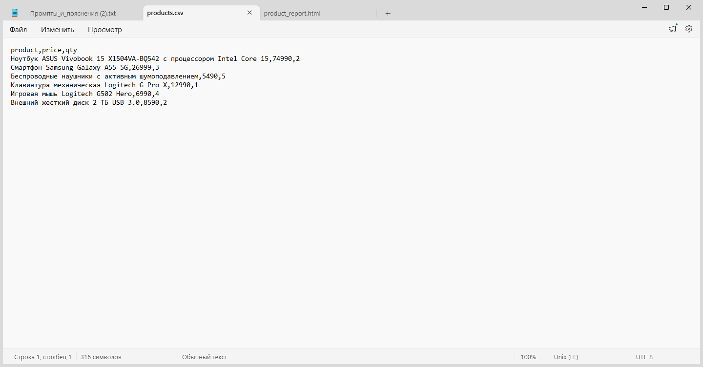
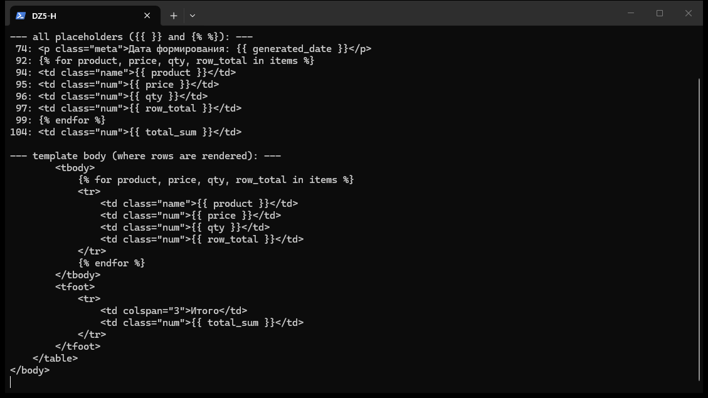
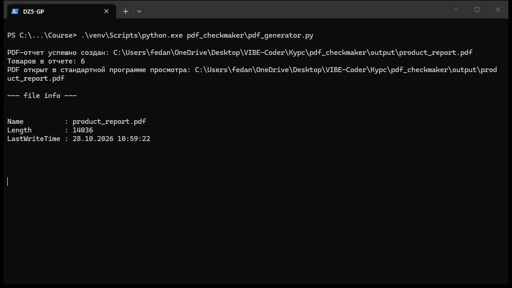
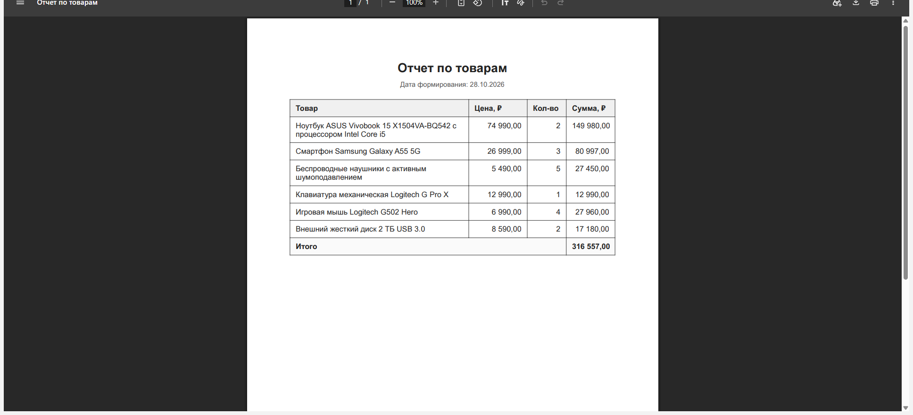
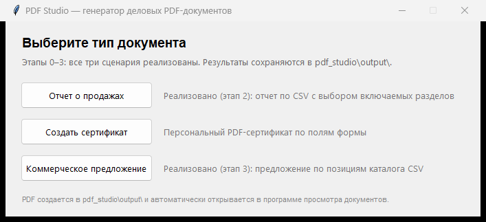
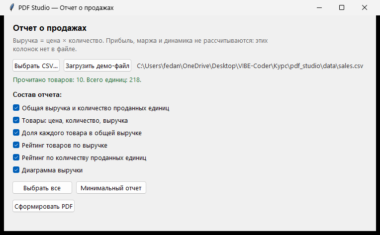
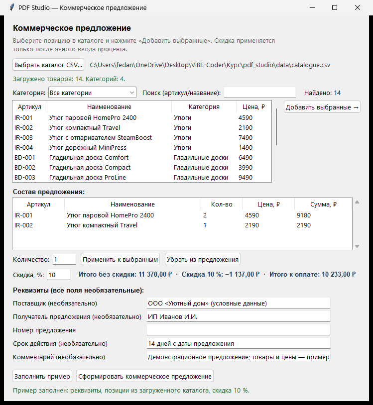
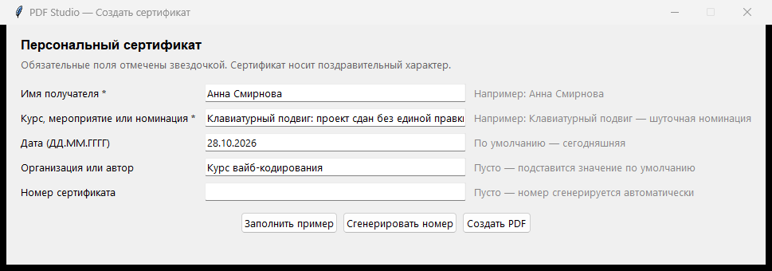
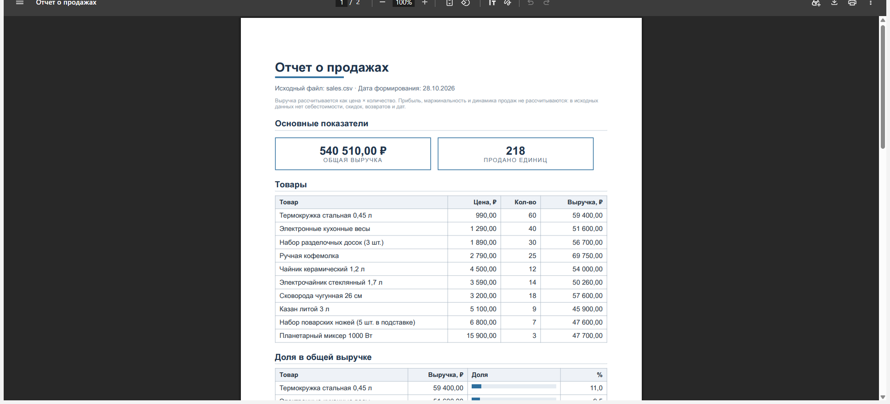
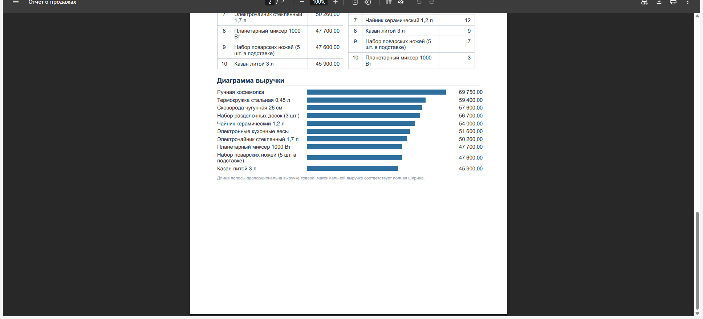

# Домашнее задание VPa06. Кейс: PDF-чек-мейкер

## 1. Название и цель

**ДЗ VPa06 «Кейс: PDF-чек-мейкер»** (курс вайб-кодирования). Цель — пройти полный цикл
вайб-кодинг-разработки: от составного промпта до работающего инструмента, который
автоматизирует рутинную операцию «из табличных данных — в готовый PDF-документ», а затем
оформить результат для сдачи (README, промпты, оффер, скриншоты, отчёт).

**Репозиторий GitHub:** https://github.com/MarfaVass/VibeCodelession (ветка `main`).

## 2. Описание проекта и решаемой задачи

Проект **`pdf_checkmaker`** — консольный генератор PDF-отчета по товарам: читает список
товаров из CSV, заполняет HTML-шаблон (Jinja2), рендерит PDF (WeasyPrint), сохраняет его
в `output/` и автоматически открывает в программе просмотра Windows. Решаемая рутина:
ручное составление накладных/чёков/списков в редакторе (копипаст, пересчет сумм,
выравнивание) заменяется одной командой.

Проект закономерно развился в **`pdf_studio`** — то же ядро генерации, но с графическим
интерфейсом и тремя сценариями (сертификат, отчет о продажах, коммерческое предложение).
`pdf_studio` — дополнительная часть: обязательные требования ДЗ целиком закрыты
`pdf_checkmaker`.

## 3. Структура проекта

```
Курс/
├── pdf_checkmaker/                  # ОСНОВНОЙ проект по ДЗ (консольный генератор)
│   ├── pdf_generator.py             # Весь пайплайн: CSV → Jinja2 → WeasyPrint → открытие
│   ├── requirements.txt             # weasyprint>=62.0, jinja2>=3.1.0
│   ├── README.md                    # Инструкция: установка, запуск, GTK на Windows
│   ├── data/products.csv            # 6 товаров (заголовок product,price,qty)
│   ├── templates/product_report.html# A4-шаблон с плейсхолдерами
│   ├── output/product_report.pdf    # Готовый PDF (штатный результат)
│   ├── OFFER.md                     # Оффер для фриланс-биржи (3–4 предложения)
│   └── PROMPT.md                    # Составной промпт (реконструкция, помечена)
├── pdf_studio/                      # Расширение с GUI (Tkinter), 3 сценария
│   ├── app.py                       # Главное окно: выбор типа документа
│   ├── common/                      # paths, csv_io, numfmt, validation, pdf_output
│   ├── documents/                   # certificate.py, sales_report.py, quotation.py
│   ├── gui/                         # окна сценариев + tk_helpers.py (Ctrl+V/C/X/A)
│   ├── templates/                   # certificate, sales_report, quotation (HTML)
│   ├── data/                        # sales.csv, catalogue.csv (демо)
│   ├── tests/                       # 95 unittest-тестов
│   ├── output/                      # PDF всех сценариев (уникальные имена)
│   └── PDF Студио.bat               # Запуск двойным кликом
└── reports/                         # Отчеты по ДЗ + скриншоты
```

## 4. Технологии и зависимости

- **Python 3.12** (Windows), стандартная библиотека: `csv`, `datetime`, `decimal`,
  `pathlib`, `os`, `tkinter` (GUI расширения), `unittest` (тесты).
- **Jinja2 3.1.6** — подстановка данных в HTML-шаблон.
- **WeasyPrint 70.0** — HTML→PDF; на Windows требует системных библиотек GTK/Pango
  (настроены через MSYS2, см. раздел 8).
- **Git/GitHub** — контроль версий (коммит `b338534` — базовая сдача проекта).

Установка зависимостей — только `pip install -r pdf_checkmaker/requirements.txt`;
новые пакеты для расширений не потребовались (GUI — Tkinter из состава Python,
диаграмма отчёта — HTML/CSS, тесты — unittest).

## 5. Как устроен процесс генерации PDF

1. **Чтение CSV** (`data/products.csv`): кодировка UTF-8 (в т.ч. с BOM) с фолбэком
   на Windows-1251; проверка обязательных колонок `product,price,qty`.
2. **Валидация**: каждая строка проверяется (незаполненные поля, не-числа, NaN,
   отрицательная цена, количество ≤ 0) — ошибка выводится по-русски с номером строки,
   выход с кодом 1.
3. **Форматирование**: суммы — `1 234,50` (пробел — тысячи, запятая — копейки).
4. **Шаблон** (`templates/product_report.html`): Jinja2 подставляет строки таблицы и
   итог, `autoescape` включен для безопасности.
5. **Рендер**: WeasyPrint `HTML(string=html, base_url=templates/).write_pdf(output)`.
6. **Результат**: сохранение в `output/product_report.pdf`, `os.startfile` открывает
   PDF в системном просмотрщике Windows.

Все пути определяются от расположения самого скрипта — запуск работает из любой папки.

## 6. Формат входных данных и пример CSV

```csv
product,price,qty
Ноутбук ASUS Vivobook 15 X1504VA-BQ542 с процессором Intel Core i5,74990,2
Смартфон Samsung Galaxy A55 5G,26999,3
Беспроводные наушники с активным шумоподавлением,5490,5
Клавиатура механическая Logitech G Pro X,12990,1
Игровая мышь Logitech G502 Hero,6990,4
Внешний жесткий диск 2 ТБ USB 3.0,8590,2
```

- `product` — название (может быть длинным — переносится в PDF);
- `price` — цена за единицу (точка или запятая в десятичных);
- `qty` — количество > 0.

## 7. HTML-шаблон и плейсхолдеры

A4-документ с таблицей (шапка, строки, итог) и датой формирования.
Плейсхолдеры (строки шаблона, см. скриншот 2):

| Плейсхолдер | Назначение |
|---|---|
| `{{ generated_date }}` | дата формирования отчета |
| `` | цикл по строкам товаров |
| `{{ product }}`, `{{ price }}`, `{{ qty }}`, `{{ row_total }}` | поля строки таблицы |
| `{{ total_sum }}` | итоговая сумма заказа |

## 8. Инструкция по установке и запуску (Windows PowerShell)

Полная версия — в `pdf_checkmaker/README.md`. Кратко (от корня репозитория):

```powershell
# Зависимости — один раз, в существующее venv репозитория
.\venv\Scripts\Activate.ps1
pip install -r pdf_checkmaker\requirements.txt

# Запуск
python pdf_checkmaker\pdf_generator.py
```

Без активации: `.\venv\Scripts\python.exe pdf_checkmaker\pdf_generator.py`.

Если появляется `OSError: cannot load library 'libgobject-2.0-0.dll'` — это про
системные библиотеки GTK/Pango (не pip): через MSYS2
(`pacman -S mingw-w64-ucrt-x86_64-pango`) и добавить `C:\msys64\ucrt64\bin` в `PATH`
(подробно — в `pdf_checkmaker/README.md`).

PDF Studio (расширение): `.\venv\Scripts\python.exe pdf_studio\app.py` или двойной
клик `pdf_studio\PDF Студио.bat`.

## 9. Результат реального тестового запуска (28.10.2026)

- `python -m py_compile` обоих скриптов — без ошибок.
- Реальный запуск `pdf_checkmaker\pdf_generator.py`: выход 0; консоль напечатала
  «PDF-отчет успешно создан», «Товаров в отчете: 6», «PDF открыт в стандартной
  программе просмотра»; файл `output\product_report.pdf`: 14 036 байт, 1 страница,
  A4 (596×842 pt), заголовок `%PDF-`. Итог PDF: **316 557,00 ₽** (см. скриншот 4).
- Тесты `pdf_studio`: `python -m unittest discover pdf_studio\tests` — **95 из 95 OK**
  (сертификат 17, отчет о продажах 27, коммерческое предложение 45, шорткаты 6).

Приложение-расширение проверено пользователем вручную (генерация всех трех PDF,
автооткрытие, Ctrl+V в полях).

## 10. Скриншоты

Файлы — в `reports/screenshots/homework_05_pdf_chekmaker/` (настоящие снимки окон,
сделанные PrintWindow-API; скриншот просмотрщика обрезан сверху, чтобы не публиковать
личные вкладки браузера).


*Рис. 1. Входные данные: `data/products.csv` — заголовок и 6 товаров.*


*Рис. 2. Плейсхолдеры шаблона (`{{ }}`/``) с номерами строк.*


*Рис. 3. Реальный запуск: PDF создан, 6 товаров, файл открыт автоматически.*


*Рис. 4. Готовый PDF: кириллица, таблица, Итого 316 557,00 ₽.*


*Рис. 5. Расширение pdf_studio: выбор одного из трех сценариев.*


*Рис. 6. Сценарий «Отчет о продажах»: демо-файл загружен, выбор разделов.*


*Рис. 7. Коммерческое предложение: каталог, состав, скидка 10 %, итоги.*


*Рис. 8. Сценарий «Создать сертификат»: форма с демо-заполнением.*


*Рис. 9. Готовый PDF-отчет, страница 1: основные показатели, таблица товаров, начала долей.*


*Рис. 10. Страница 2: рейтинги и диаграмма выручки (крутые полосы — фактические значения).*


*Рис. 11. Готовый PDF-сертификат: рамка, номинация, номер PS-20261028-0786, оговорка о поздравительном характере.*


*Рис. 12. Готовое КП: три позиции утюгов, скидка 10 %, Итого 30 456,00 ₽.*

## 11. Проверка требований задания

| Требование | Подтверждение | Статус |
|---|---|---|
| CSV с ≥ 3–5 строками | `products.csv`: 6 товаров | ✅ |
| HTML-шаблон с плейсхолдерами | 7 плейсхолдеров (рис. 2) | ✅ |
| Python читает CSV и подставляет данные | `pdf_generator.py`, `render_html()` | ✅ |
| PDF сохраняется в `output` | `output/product_report.pdf` (14 036 Б) | ✅ |
| PDF открывается автоматически | `os.startfile`; подтверждено запуском и скрином | ✅ |
| Составной промпт зафиксирован | `pdf_checkmaker/PROMPT.md` (реконструкция, помечена) | ✅ |
| Оффер 3–4 предложения | `pdf_checkmaker/OFFER.md` + раздел 13 отчёта | ✅ |
| Файлы в GitHub | публикация выполняется финальным коммитом и push; актуальный статус — по истории `main` | ⚠️ см. разделы 15 и 17 |

Отдельные дополнительные возможности (сверх обязательного минимума, реализованы
в `pdf_studio`): GUI на Tkinter с тремя сценариями; отчет о продажах — выбор разделов
флажками, рейтинги, доли, CSS-диаграмма, агрегация дублей; коммерческое предложение —
категории из данных файла, поиск, состав, скидка 0–90 %, итоги в `Decimal`;
сертификат — валидация полей, автономер; уникальные имена PDF (без перезаписи);
95 unittest-тестов; шорткаты Ctrl+V/C/X/A при русской раскладке; «PDF Студио.bat».

Примечание: обязательные пункты ДЗ не путаются с доп. возможностями — базовый
сценарий закрывается одним файлом `pdf_generator.py` без GUI.

## 12. Примеры использованных промптов

Источник — `pdf_checkmaker/PROMPT.md`: **исходный промпт не сохранился в файлах**,
там опубликована реконструкция, явно помеченная как восстановленный вариант.
Ниже — содержательные примеры промптов, соответствующих реальному процессу;
они подготовлены для документации (не дословная история переписки).

**Промпт 1 — первоначальная генерация.**
«Создай консольный Python-скрипт, который читает CSV со столбцами product, price, qty,
загружает HTML-шаблон с плейсхолдерами Jinja2, подставляет данные, рендерит PDF через
WeasyPrint, сохраняет в папку output и автоматически открывает файл. Пути считай
от расположения скрипта.»

**Промпт 2 — уточнение требований.**
«Добавь корректную работу с кириллицей (UTF-8 и Windows-1251), перенос длинных
названий товаров в таблице, аккуратную табличную верстку с итоговой строкой, понятные
сообщения об ошибках на русском с номером строки и корректную работу путей в Windows —
запуск из любой текущей папки терминала.»

**Промпт 3 — исправление ошибки (по факту traceback).**
«Запуск завершился ошибкой: [вставить вывод traceback]. Проанализируй его, найди
корень причины, исправь минимальными изменениями рабочий код, потом перезапусти
скрипт и подтверди, что PDF создан и содержимое корректно. Ошибки не маскируй.»

**Промпт 4 — тестирование.**
«Проверь проект: соответствие колонок CSV ожидаемому заголовку, подстановку значений
в шаблон (плейсхолдеры получают фактические данные), корректность итоговых сумм
на контрольном примере, наличие и валидность PDF в output и автоматическое открытие.
Отче: что проверено, что нет.»

**Промпт 5 — оффер для биржи.**
«На основе реально работающего проекта напиши оффер для фриланс-биржи на 3–4
предложения: автоматизация создания PDF-документов из табличных данных. Опиши целевую
аудиторию и преимущество по скорости. Не обещай функций, которых нет в текущей
реализации.»

## 13. Оффер для фриланс-биржи

Актуальная редакция — `pdf_checkmaker/OFFER.md`:

> **Автоматизирую подготовку PDF-документов из ваших табличных данных: отчетов, каталогов товаров, коммерческих предложений и сертификатов.**
> Настрою обработку исходных данных и оформление под вашу задачу, чтобы вместо ручного копирования и выравнивания получать готовый документ за несколько секунд. Решение проверяет входные данные, корректно обрабатывает кириллицу и сообщает об ошибках понятным языком; форматы загрузки и состав документов согласуем под ваш процесс. Подходит малому бизнесу, продавцам на маркетплейсах и специалистам, которые регулярно формируют однотипные документы и хотят убрать из этого ручной труд.

*Выдерживается ограничение: описана только фактически работающая функциональность.*

## 14. Известные ограничения и незавершённые пункты

- **WeasyPrint на Windows требует GTK/Pango** — системные библиотеки ставятся не через
  pip (MSYS2/installer); на другой машине нужен раздел README об этом.
- Консольный скрипт **перезаписывает** `product_report.pdf` при каждом запуске — это
  штатное поведение базового ДЗ (в `pdf_studio` уникальные имена файлов).
- Извлечение текста прямо из PDF требует дополнительного пакета (pypdf) — текстовые
  проверки выполнялись на отрендеренном HTML и визуально на скриншоте.
- `pdf_studio`: визуальная полировка сертификата и диаграммы отложена (работает корректно).
- Требование «файлы проекта в GitHub»: на момент подготовки отчёта публикация
  выполнялась финальным коммитом и push (подробности — раздел 15).

## 15. Список файлов для сдачи

Обязательно: `pdf_checkmaker/pdf_generator.py`, `requirements.txt`, `README.md`,
`data/products.csv`, `templates/product_report.html`, `output/product_report.pdf`,
`OFFER.md`, `PROMPT.md`, этот отчёт + скриншоты (12 рисунков).
Дополнительно (расширение): папка `pdf_studio/` (код, шаблоны, демо-данные, тесты,
`PDF Студио.bat`, README).

Состояние Git (фактическое, сверено с GitHub): на момент подготовки отчёта коммит
`b338534` с базовым проектом `pdf_checkmaker/` существовал только локально — на
GitHub была более старая версия (`80574d4`), публикация еще не была выполнена.
Изменения после этого коммита (обновлённые README, `pdf_studio/`, отчёт, скриншоты)
были не закоммичены. Публикация обоих пакетов изменений выполняется финальным
коммитом этого цикла (актуальный статус — по истории `main` репозитория).

## 16. Возможные доработки и адаптация под задачи клиента

Проект — готовая основа для индивидуальных инструментов автоматизации документов.
Разделяем два уровня: **реализовано сейчас** (подтверждено кодом и тестами) и
**возможно реализовать под заказ** (направления развития, не выдаваемые за готовые функции).

### Реализовано сейчас (проверено)

- Три сценария PDF: сертификат, аналитический отчет о продажах, коммерческое
  предложение; CSV→HTML→PDF→автооткрытие; валидация данных с русскими сообщениями;
  `Decimal`-расчеты, рейтинги, доли, диаграмма; уникальные имена файлов; 95 тестов.

### Возможно реализовать под заказ (не является готовой функциональностью)

1. **Загрузка и обработка данных из Excel** (`.xlsx`/`.xls`): импорт вместо ручной
   подготовки CSV; выбор листа и диапазона; сопоставление колонок с полями документа;
   обработка пустых ячеек, дат, чисел и денежных форматов; отчет об ошибках импорта.
2. **Каталоги и прайс-листы из Excel заказчика**: импорт номенклатуры, артикулов,
   категорий, цен и описаний; фильтрация по параметрам; генерация каталогов, подборок
   и коммерческих предложений; фирменное оформление, логотипы, фотографии (состав и
   сложность зависят от структуры каталога и количества товаров).
3. **Массовое формирование сертификатов по спискам из Excel**: список участников →
   отдельный PDF на каждого (или единый файл); автоматическая нумерация; настройка
   номинации/организации/даты; отчет о созданных документах; при необходимости — архив
   и реестр выдачи.
4. **Отчетность по образцу заказчика**: анализ его существующего отчета; определение
   входных данных и правил (выручка, себестоимость, маржа — если данные доступны);
   таблицы, итоги, группировки, фирменное оформление; настройка периодов и фильтров.
   Точное воспроизведение сложного многостраничного образца оценивается отдельно после
   анализа материалов.
5. **Другие направления**: счета, акты, накладные по типовым шаблонам; пакетная
   генерация из CSV/Excel/JSON; персонализированные письма-документы; адаптация под
   фирменный стиль (шрифты, цвета, подписи); интеграция с CRM/БД/API, когда это
   оправдано; альтернативные интерфейсы (desktop, Telegram-бот).

### Пользовательский запуск — отдельное направление развития

Сейчас решение требует подготовленного Python-окружения (интерпретатор, `venv`,
установленные зависимости); двойной клик по `PDF Студио.bat` дает упрощенный запуск,
но опирается на уже настроенное окружение. Направления доработки:

**A. Автономное настольное приложение** — установка и запуск двойным щелчком без
самостоятельной установки Python, создания `venv` и библиотек: сборка в исполняемый
файл со встроенным Python и зависимостями.

**B. Веб-интерфейс** — пользователь в браузере: загружает CSV или Excel, выбирает
сценарий, заполняет поля, получает готовый PDF. Требует отдельного проекта исполнения:
локальное веб-приложение (обработка на компьютере пользователя, данные не покидают
ПК) или веб-сервис (обработка на сервере). Статичная HTML-страница не заменяет
Python-логику — нужен работающий механизм обработки на стороне исполняющей среды.

**C. Удобная выдача документов** — выбор папки сохранения, предварительный просмотр
перед сохранением, повторная генерация из того же набора данных, понятные статусы
и возможность открыть/скачать готовый PDF.

Выбор архитектуры (A/B/C или их сочетание) зависит от требований заказчика,
конфиденциальности данных и способа распространения решения.

### Интеграции и другие документы

Пакетная генерация по списку, документы из CRM/БД/API, альтернативные интерфейсы —
направления индивидуальной доработки; сейчас в приложении нет интеграций со
сторонними системами. Все перечисленное — возможный объем работ, а не реализованное.

### Как организуется работа по доработке

1. Заказчик присылает образец исходных данных и образец готового документа.
2. Согласуются обязательные поля, правила расчета, объемы и требования к оформлению.
3. Фиксируется техническое задание и формат результата.
4. Создается или адаптируется шаблон и логика обработки данных.
5. Проверка на реальных примерах заказчика (контрольные числа).
6. Передача решения с инструкцией.

Наличие образца документа и 2–3 типовых исходных файлов до начала работы позволяет
точнее оценить объем и сократить число правок.

### Практическая ценность

Автоматизация повторяющихся операций с документами: меньше ручного ввода, меньше
случайных ошибок копипаста, быстрее готовая отчетность. Надежность обеспечивается
не «отсутствием ошибок», а конструктивно: проверкой входных данных с понятными
сообщениями, тестированием расчетов и согласованием результатов с заказчиком
на контрольных примерах.

---

## 17. Статус готовности к сдаче

**Проект готов к сдаче** — все обязательные пункты ДЗ выполнены и подтверждены
реальными запусками (раздел 9), материалы оформлены в этом отчёте, публикация в
GitHub выполняется финальным коммитом и push (сверьте актуальное состояние по
истории `main`).

После сдачи полезно сделать (не блокирует сдачу):
1. Визуальную полировку сертификата и диаграммы отчета о продажах (работает корректно).
2. Направления доработки из раздела 16 — по запросам клиентов.