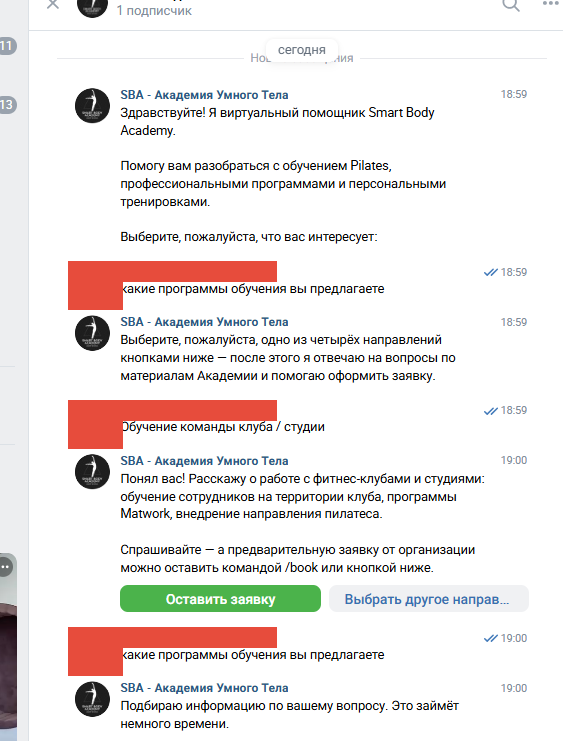
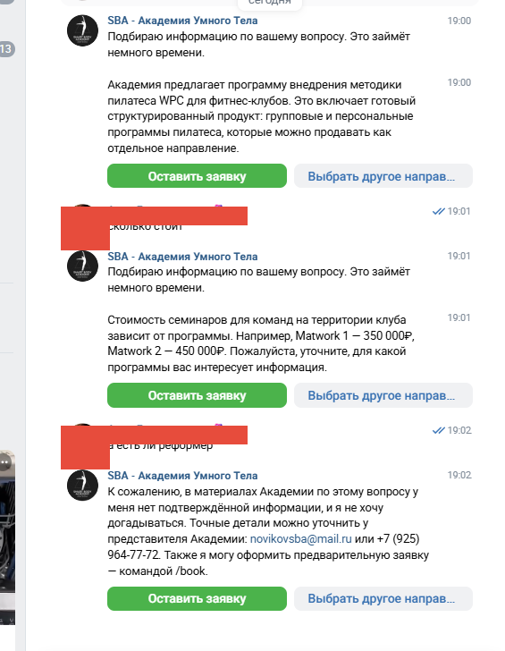
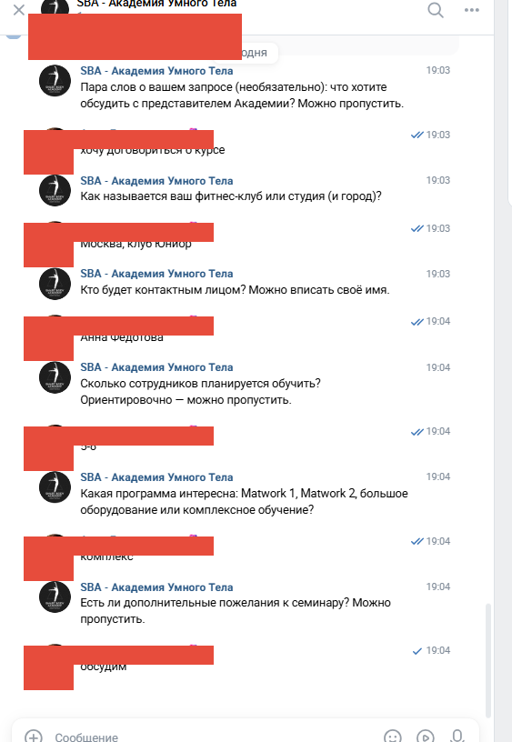
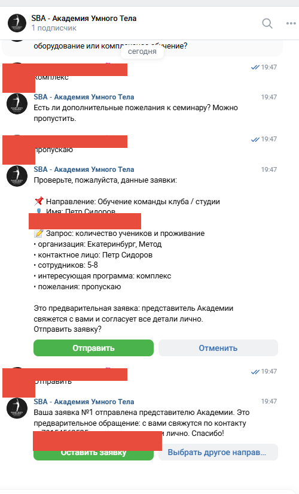
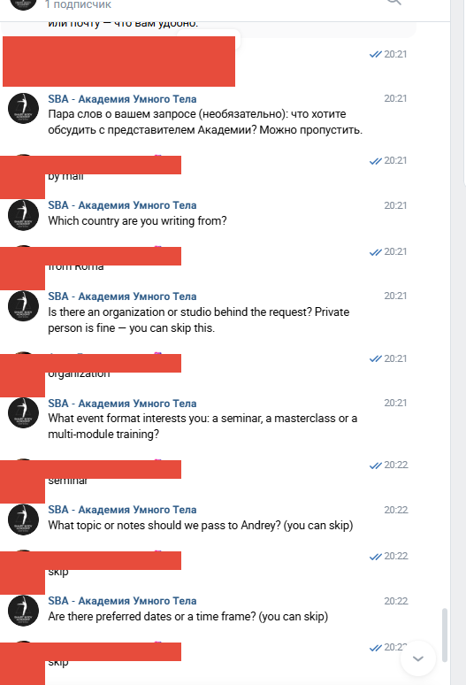
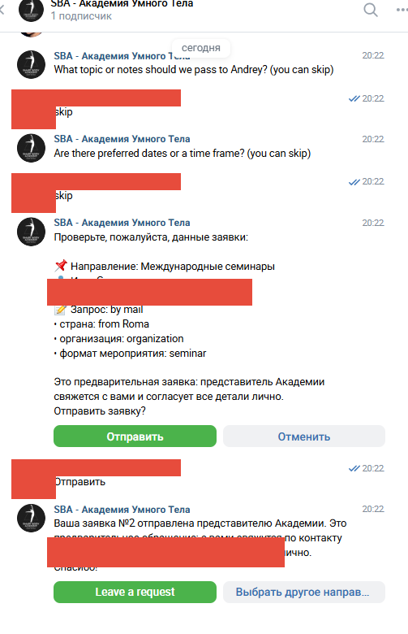
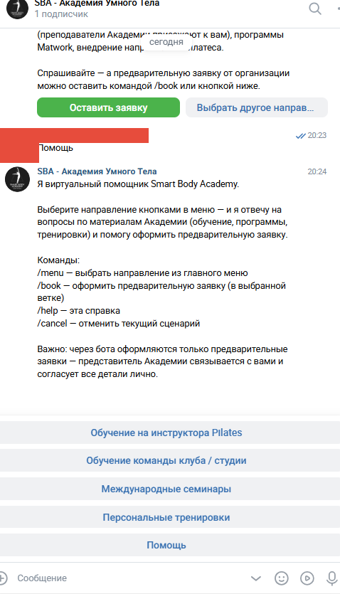
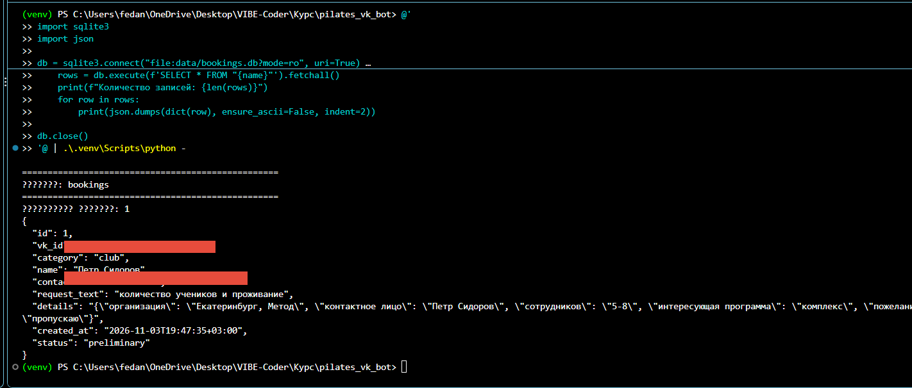

# ДЗ № 06 — Бот в мессенджере (Вариант 2): VK-бот Smart Body Academy

Проект: `pilates_vk_bot` (папка проекта в репозитории рядом с отчётом).
Сообщество ВКонтакте: Smart Body Academy — Академия умного тела Андрея Новикова, сайт https://smartbodyacademy.ru/

---

## 1. Описание задачи и назначение бота

Smart Body Academy проводит обучение Pilates в нескольких форматах: подготовка инструкторов, обучение команд клубов и студий, международные семинары и персональные тренировки. Постоянный поток вопросов приходит в личные сообщения сообщества ВКонтакте: «сколько стоит обучение», «выезжаете ли вы к нам в студию», «есть ли программа на английском», «как записаться на тренировку».

Рутинная задача, которую решает бот — **первая линия общения с клиентом в личных сообщениях сообщества**: помочь человеку сориентироваться в четырёх направлениях академии, ответить на типовые вопросы по фактам из базы знаний и собрать предварительную заявку, чтобы представитель академии дальше работал не с «пустым» обращением, а с уже структурированными данными (имя, контакт, направление, запрос, детали).

Ключевое ограничение по замыслу: бот **не заменяет менеджера**. Заявка через бота — только предварительная; бот не обещает цены, которых нет в базе, не называет конкретные даты и свободные места и не даёт медицинских советов. В сложных случаях он честно предлагает оставить заявку или написать напрямую представителю академии.

---

## 2. Тематика и используемая модель ИИ

**Тематика** — обучение и услуги академии Pilates: четыре направления работы (см. раздел 3), программы, форматы, условия обучения.

**Стек:** Python 3.14, vkbottle 4.11 (Long Polling, текстовые кнопки с payload), локальный **Ollama** с моделью **`qwen2.5:3b-32k`** (значение задаётся переменной `OLLAMA_MODEL` в `.env` — реальные адрес, токен и секреты в отчёт не выносятся), SQLite для заявок, pytest для тестов. Модель работает на локальной машине через `/api/chat`; поскольку это небольшая модель на CPU, ответ ограничен `num_predict = 150` токенов, а `keep_alive = -1` держит модель в памяти, чтобы после паузы не ждать повторной загрузки (~10 секунд).

**Роль системного промпта.** Модель отвечает только на основе найденных фрагментов базы знаний (RAG). Реальная выдержка из `bot/prompts/system.txt`:

> Используй ТОЛЬКО факты из фрагментов ниже. Не придумывай цены, расписание, условия, программы, даты и результаты. Если во фрагментах нет ответа — скажи, что точную информацию стоит уточнить у представителя Академии, и предложи оставить заявку командой /book.
>
> Не давай медицинских советов и не оценивай здоровье. Если во фрагментах есть оговорка о консультации врача (травмы, диагнозы, беременность, послеоперационный период) — обязательно передай её.
>
> Заявка через бота только предварительная: представитель свяжется с клиентом и согласует детали. Не обещай свободные места и конкретное время.

**RAG.** База знаний — 10 небольших документов с frontmatter (`title`, `category`, `source`, `collected`), разбитых на 49 фрагментов-абзацев: по документам на каждое направление плюс общие документы (`common` — контакты, об академии). Поиск — собственный `KeywordRetriever`: ключевые слова вопроса (со стоп-словами и усечением окончаний) сопоставляются с текстами фрагментов, к найденным добавляется порог-score и fuzzy-совпадения; при отсутствии достаточно релевантных фрагментов модель вообще не вызывается — бот честно отвечает, что данных нет (см. скриншот 2).

**Международное направление — фиксированное, без модели.** Для ветки «Международные семинары» ответы полностью фиксированы (`INTERNATIONAL_INFO`): они на английском (программа ориентирована на англоязычных партнёров, у которых академия ведёт выездные семинары), не зависят от LLM и всегда одинаковы. LLM используется только в ветках обучения инструкторов, обучения команд клубов и персональных тренировок.

---

## 3. Пользовательские сценарии и кастомная логика

Бот обслуживает **четыре направления**, каждое со своей логикой и своей анкетой:

| Направление | Логика ветки | Анкета |
|---|---|---|
| Обучение на инструктора Pilates (specialist) | вопросы по программе + RAG-ответы; заявка | направление программы, опыт, формат обучения |
| Обучение команды клуба / студии (club) | выезд преподавателей академии на территорию заказчика; вопросы по условиям и ценам + RAG; заявка | **организация (обязательно)**, контактное лицо, число сотрудников, программа, пожелания |
| Международные семинары (international) | фиксированная справка на английском, без LLM | country, organization, event format, topic, сроки — анкета на английском |
| Персональные тренировки (client) | вопросы по форматам и ценам (студия/онлайн/выезд) + RAG; заявка | формат, способ занятий, пожелания |

**Направление выбирается ТОЛЬКО кнопкой.** Автоматическая классификация текста модели удалена сознательно: сначала кнопочная категоризация пробовалась, но модель малой размерности стабильно путала «инструктора» и «персональные тренировки», поэтому выбор направления — это всегда явное нажатие одной из четырёх кнопок главного меню. До выбора направления текстовые сообщения пользователя бот обрабатывает без попытки угадать категорию.

**Кнопки и команды:** главное меню (4 направления + «Помощь»), внутри направления — «Оставить заявку» и «Выбрать другое направление», в анкете — подтверждение и отмена («Отправить» / «Отменить»), пропуск необязательных полей текстом («пропустить», «-», «нет») и переход по командам `/start`, `/menu`, `/help`, `/cancel`, `/book`.

**Сценарий заявки (конечный автомат BookingFlow):** имя → контакт → описание запроса → дополнительные поля своего направления → сводка → подтверждение → сохранение. У каждого направления свои поля: у клуба «организация» обязательно (без него заявку не принять), у международных — все поля на английском. Необязательные поля можно пропустить.

**Попутные вопросы внутри анкеты.** Если во время заполнения анкеты человек задаёт обычный вопрос («а сколько стоит?»), бот отвечает на него из базы знаний (RAG) и **возвращается к анкете с того же поля** — заявка не сбрасывается.

**Переключение направления во время заявки** сопровождается подтверждением: «Сменить направление? Заполненные ответы будут потеряны» — с кнопками да/нет, поэтому случайный клик не уничтожает черновик.

---

## 4. Демонстрация работы

Скриншоты лежат в папке `screenshots` рядом с отчётом и встроены ниже (обезличены: телефоны, vk_id, имя и аватар тестового аккаунта замаскированы).

**1. Приветствие и главное меню.** Бот приветствует клиента и показывает меню из четырёх направлений кнопками; выбор направления — только кнопкой.



**2. Ответы по базе знаний (ветка клуба).** Вопросы об условиях обучения команды клуба: бот отвечает на основе найденных фрагментов (цены выезда: Matwork 1 — 350 000 ₽, Matwork 2 — 450 000 ₽, обучение на большом оборудовании — 150 000 ₽), а на вопрос, данных о котором в базе нет, честно отвечает, что точную информацию нужно уточнить у представителя.



**3. Анкета клуба.** Последовательный сбор полей ветки клуба: организация (обязательно), контактное лицо, число сотрудников, пожелания; необязательные поля пропускаются.



**4. Сводка, подтверждение и сохранение заявки.** Бот показывает сводку, после подтверждения сохраняет заявку и сообщает об этом.



**5. Международная анкета (на английском).** Ветка «Международные семинары» ведёт анкету на английском: country, organization, event format, topic, сроки.



**6. Международная заявка подтверждена и сохранена.**



**7. Команда /help.** Справка с полным описанием возможностей и кнопки главного меню.



**8. Запись в базе данных.** Сохранённая заявка, прочитанная напрямую из SQLite (vk_id, направление, имя, контакт, детали, статус `preliminary`).


   Сохранённая заявка, прочитанная напрямую из SQLite (vk_id, направление, имя, контакт, детали, статус `preliminary`).

---

## 5. Что сделано по-своему

Ниже — решения, фактически реализованные в коде (не заимствованные из шаблона задания):

- **Четыре направления с разной логикой в одном боте**: три ветки с RAG-ответами и одной фиксированной международной веткой на английском без LLM — под каждую категорию отдельная анкета со своими полями.
- **Выбор направления только кнопками**: классификатор текста на базе LLM был заменён на явный кнопочный выбор — модель малой размерности стабильно путала направления, а кнопка даёт предсказуемое поведение.
- **RAG «на минималках» без внешних сервисов**: собственный поиск по ключевым словам по 49 фрагментам (стоп-слова, усечение окончаний, fuzzy-совпадения), модель получает только найденные фрагменты; если релевантных фрагментов нет — модель не вызывается вовсе и бот честно отказывается отвечать.
- **Ограничение галлюцинаций системным промптом**: модель запрещено придумывать цены, расписание и условия; есть оговорка про медицинские советы; заявка всегда «только предварительная».
- **Диалог-менеджер как конечный автомат**: у каждого пользователя своё состояние (выбранное направление, шаг анкеты, ожидание подтверждения); попутные вопросы внутри анкеты отвечаются через RAG и возвращают пользователя к анкете с того же поля.
- **Обработка переключения направления и незавершённой анкеты**: смена направления подтверждается отдельно, чтобы не потерять заполненные ответы; в команде `/cancel` — отмена заявки; возвращение после ответа на попутный вопрос.
- **Собственная структура хранения**: таблица заявок в SQLite с деталями в JSON и статусами (см. раздел 6); база и схема создаются автоматически при первом запуске.
- **Устойчивость к ошибкам Ollama**: все ошибки нормализуются (не запущена, таймаут, HTTP-ошибка, пустой ответ) и превращаются в понятное для клиента сообщение, бот при этом не падает.
- **Учёт ограничений VK API**: подгонка подписей кнопок под лимит 40 символов (VKAPIError 911), лимит сообщения 4096 символов, inline-клавиатуры без `one_time`, статус «печатает…» пока модель думает.

---

## 6. Хранение данных

Заявки хранятся в локальной базе SQLite (`data/bookings.db`, путь настраивается), таблица создаётся автоматически при первом обращении.

Таблица `bookings`: `id`, `vk_id`, `category`, `name`, `contact`, `request_text`, `details` (JSON с дополнительными полями анкеты конкретного направления), `created_at` (ISO-время), `status`. В базу запись попадает **после подтверждения пользователем** по сводке; обязательные поля — имя и контакт.

Статусы: `preliminary` (по умолчанию — предварительное обращение, ждёт обработки представителем), `processed` (обработано), `cancelled` (отменено пользователем). Смена статусов предусмотрена для дальнейшей работы представителя с заявками.

В отчёт и скриншоты реальные персональные данные не выносятся (телефоны и vk_id маскируются); в базу попадают только то, что пользователь сам ввёл в анкету, — заявка тестировалась на заведомо фиктивных данных.

---

## 7. Результаты тестирования

**Автотесты** (запущены перед сдачей на актуальной версии кода):

```
.venv\Scripts\python -m pytest
= 89 passed in ~13 s =
```

Покрыто автотестами (89 тестов): клиент Ollama (нормализация ошибок, обрезка ответа), конечный автомат анкеты (все шаги, обязательные поля, пропуск, подтверждение/отмена, попутные вопросы), хранение SQLite (сохранение, статусы, обязательные поля), поиск по базе знаний (релевантность, порог), диалоговый менеджер (меню, выбор направлений, переключение, подтверждение смены, межнаправления фиксированная ветка), клавиатуры, сборка сообщений. Также прогнана проверка компиляции всех модулей (`compileall` — без ошибок).

**Ручное тестирование в VK** выполнялось по веткам **обучения команды клуба** и **международных семинаров**, а также по сохранению заявок обеих веток в базу (скриншоты 1–6 и 8). Ветки обучения инструкторов и персональных тренировок прошли автотесты, но в VK вручную по полному сценарию не прогонялись — это указано здесь честно.

---

## 8. Личный вывод

Что удалось, на мой взгляд, лучше всего — довести бота до состояния, где им действительно можно пользоваться, а не «демо-версия»: четыре направления с разными анкетами, ответы строго по базе знаний без выдумок, заявки аккуратно складываются в базу и видны представителю. Особенно понравилось то, как разрешился вопрос с классификацией: я сначала поверила, что модель сама определит направление по тексту, а когда она начала путать «инструктора» и «персональные тренировки», честно отказалась от этой идеи и перевела выбор на кнопки — решение получилось надёжнее и проще одновременно.

Сложнее всего было то, чего я не планировала в начале: скорость работы маленькой модели на CPU (решили лимитом токенов и `keep_alive`), ограничения VK API (40 символов на кнопку — пришлось переформулировать меню; поведение inline-клавиатур — переоткрывала несколько раз по VKAPIError 911), и самая трудоёмкая часть — не код, а **база знаний**: раскладывать реальные материалы академии на фрагменты с понятными границами, чтобы поиску было за что «цепляться». Дольше всего возилась с пограничными состояниями диалога: что делать, если вопрос пришёл посреди анкеты, человек передумал на этапе подтверждения, сменил направление — именно эти случаи забирали больше всего времени и именно они ощущаются в итоге самыми важными для живого пользователя.

Польза бота для академии — закрыть первую линию переписки сообщества: клиент сразу получает ориентацию и отвечает на типовые вопросы по фактам, а менеджер работает с уже структурированными предварительными заявками. Для клиентской части ценность — круглосуточный ответ без «я узнаю и перезвоню» и аккуратная анкета, где не нужно вспоминать, что добавить.

---

## 9. Возможности развития

Список — планы, **ни одна из функций ещё не реализована**:

- **Двуязычный интерфейс** (русский/английский) для всего бота, а не только международной ветки;
- расширение базы знаний новыми документами и переход от keyword-поиска к векторному RAG;
- развертывание на сервере (сейчас бот и Ollama работают на локальной машине);
- админ-панель для просмотра и работы со статусами заявок;
- экспорт заявок в Excel для менеджеров;
- интеграция с CRM, чтобы предварительные заявки попадали в общую воронку;
- уведомления сотрудникам академии о новых заявках в личные сообщения/телеграм;
- приём заявок с сайта на Tilda через бота.