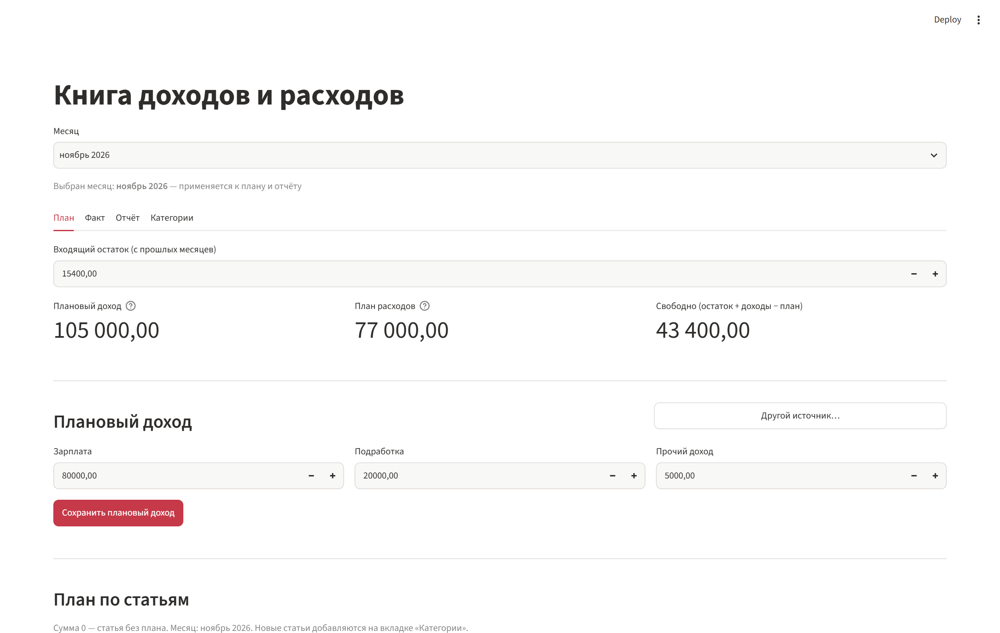
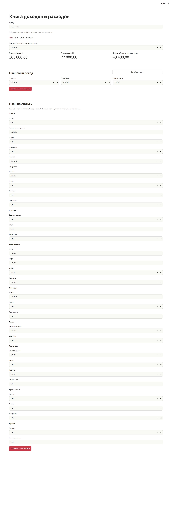
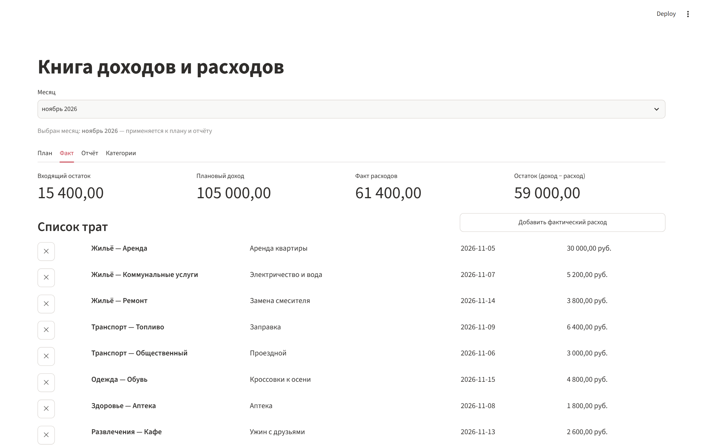
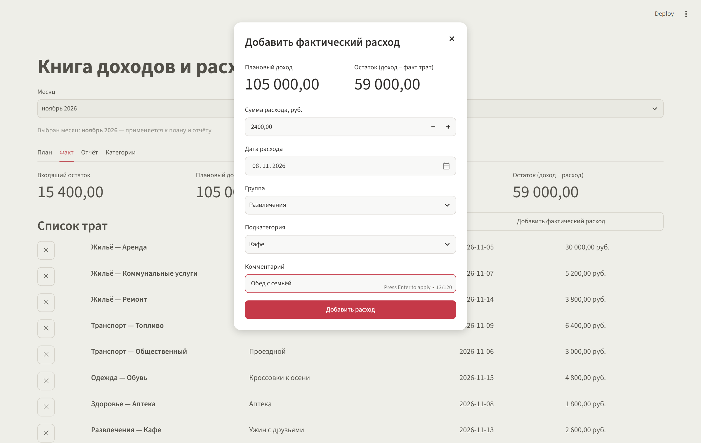
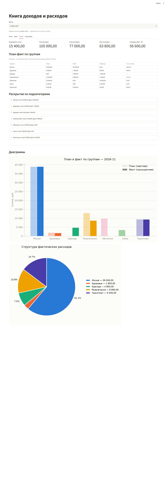
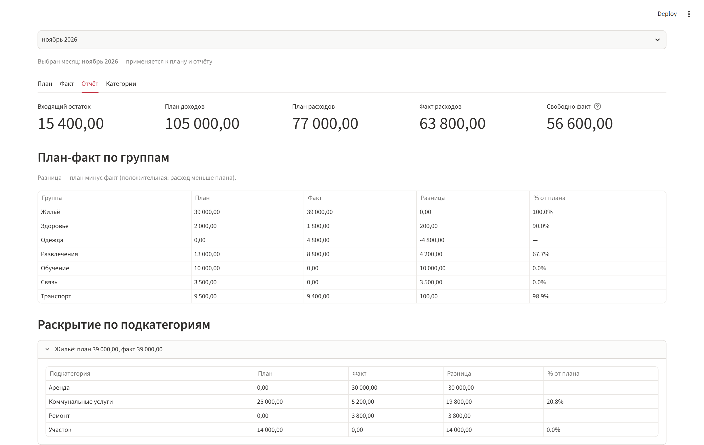
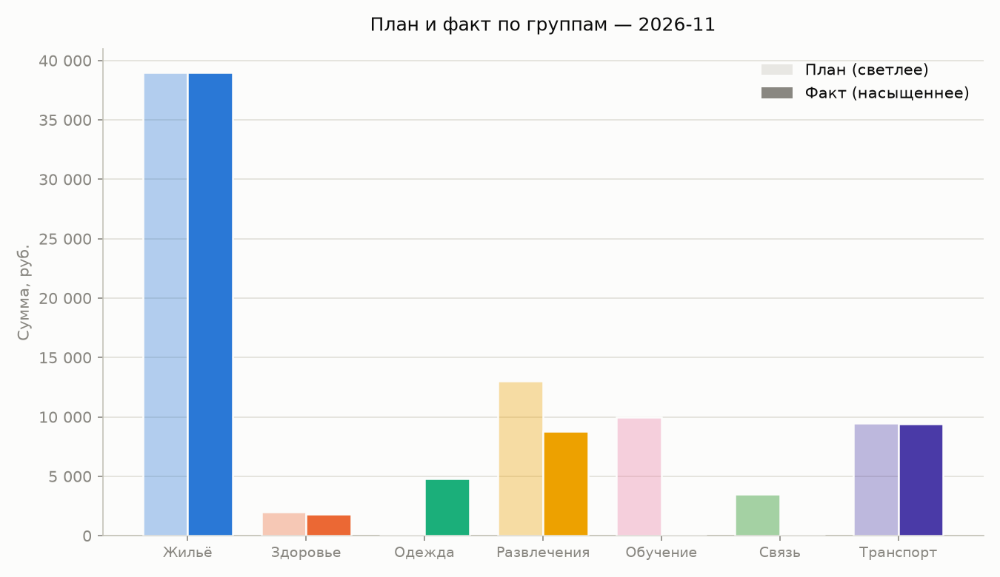
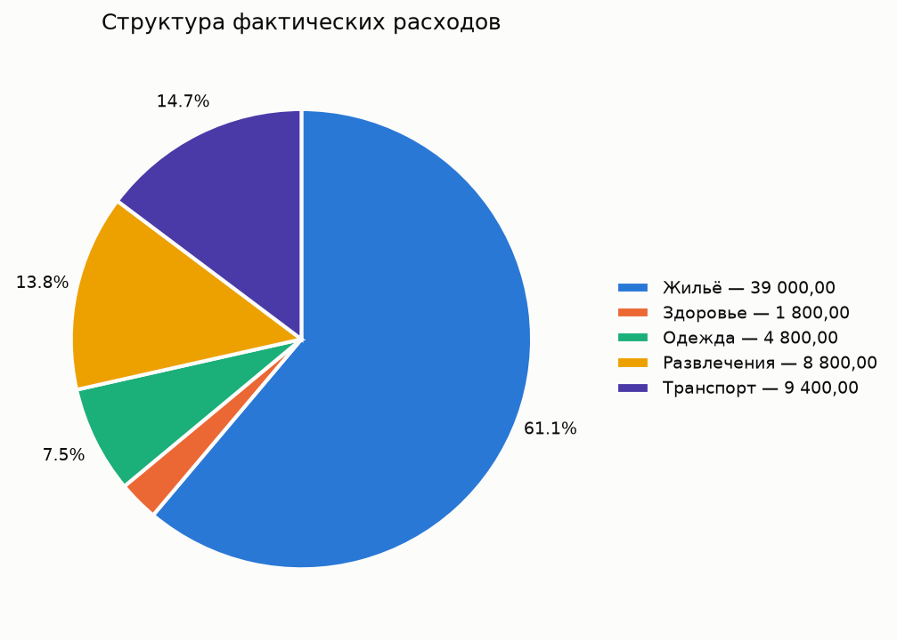

# ДЗ № 07 — Проект по собственной идее: «Книга доходов и расходов» (budget_book)

Проект: `budget_book` (папка проекта в репозитории рядом с отчётом).
Скриншоты: папка `screenshots` рядом с отчётом (`../screenshots/homework_07_budget/`).

Финальное состояние — **локальное веб-приложение на Streamlit** (`streamlit run app.py`); история развития: v1 — консольная версия (`python main.py`, коммит `4182686`), v2 — перевод в Streamlit (`db6330d`), v3 — двухуровневые категории (`5728e01`).

---

## 1. Идея проекта

**Задача.** Вести семейный персональный бюджет на локальной машине: планировать доходы и статьи расходов на месяц, записывать фактические траты, видеть план-факт по категориям и структуру расходов. Всё локально и бесплатно: без внешних API, баз данных, токенов и облачных сервисов — только Python, JSON-файлы и matplotlib.

**Принцип, который я хотел заложить с самого начала:** приложение должно отвечать на один практический вопрос — «сколько денег я могу потратить до конца месяца». Отсюда финальная компоновка: входящий остаток и плановый доход видны наверху, свободный остаток пересчитывается на каждом экране, и когда план трат превышает доступное — интерфейс честно подсвечивает перерасход ещё **на этапе планирования**, а не когда деньги уже потрачены.

**Почему это «идея», а не упражнение.** Существующие трекеры (Дзен-деньги, CoinKeeper) требуют аккаунтов и телефонов, а простой «план месяца на листочке» не умеет пересчитывать проценты и не оставляет истории. Здесь — один JSON-файл, который можно открыть блокнотом, отредактировать руками и закоммитить в git; при этом интерфейс как у полноценной веб-страницы.

---

## 2. Стек и ограничения

| Компонент | Что и зачем |
|---|---|
| Python 3.14.8 (системный) / 3.12.10 (venv проекта «Курс») | проверено на обоих; Streamlit 1.67.0 работает на обоих |
| Streamlit 1.67.0 | вкладки, формы, диалоги, поля с валидацией — без HTML/CSS; локальный сервер браузера |
| matplotlib 3.11.2 (режим Agg) | две диаграммы в PNG; сохраняются в корень проекта и показываются на странице |
| JSON-файлы | `data/budget.json` — данные по месяцам; `data/categories.json` — справочник статей |
| playwright (headless Chromium) | только для съёмки скриншотов отчёта, в приложение не входит |

Сознательные ограничения (в ТЗ): никаких внешних API и БД, суммы — float, всё работает офлайн.

**Палитра диаграмм** — не «на глаз»: взята проверенная категорийная палитра и прогнана скриптом-валидатором на совместимость с дальтонизмом (CVD ΔE ≥ 8 в OKlab, порог нормального зрения и контраст проверены до первого запуска). Цвет группы закреплён за её индексом в справочнике — одна и та же группа всегда одного цвета на обеих диаграммах.

---

## 3. Что в интерфейсе

**Сверху — общий для всех вкладок выбор месяца** (`ноябрь 2026`): переключает и план, и факты, и отчёт; месяцы хранятся в файле независимо друг от друга.

| Вкладка | Что делает |
|---|---|
| **План** | сводка «денег на виду»: входящий остаток (редактируемое поле), плановый доход, план расходов, свободно; перерасход подсвечивается. Плановый доход — быстрый разрез «Зарплата / Подработка / Прочий доход» плюс диалог произвольного источника. План по статьям — одна форма: заголовок группы («Жильё»), под ним поля для «Аренды», «Коммунальных услуг» и т. д.; 0 = статья без плана |
| **Факт** | та же денежная сводка, но по факту трат — остаток «доход − расход» виден при заполнении. Добавление расхода — из диалога: `группа → подкатегория` (зависимые списки), сумма, дата, комментарий; в самом диалоге сводка повторяется ещё раз. Список трат месяца с кнопками удаления |
| **Отчёт** | метрики (входящий остаток, план доходов, план/факт расходов, свободно), таблица план-факт по группам (план, факт, разница, % от плана; при нулевом плане — прочерк), раскрытие подкатегорий по каждой группе и обе диаграммы |
| **Категории** | справочник целиком (9 групп, 30 подкатегорий); добавить группу (сразу с подкатегориями) или подкатегорию; удалить с предупреждением о числе записей по статье — записи переносятся в «Прочее», ничего не теряется |

Валидация: суммы неотрицательные (`number_input` с нижней границей 0 физически не позволяет негативное значение), ноль и пустые поля не сохраняются (с сообщением), дубликаты статей отклоняются без учёта регистра и внешних пробелов («Такая категория уже есть»).

---

## 4. Демонстрация работы

Скриншоты сняты на реальных данных сессии (ноябрь 2026): демо-набор `demo.py` плюс пробные записи, введённые через сам интерфейс (план «Коммунальные услуги 25 000», «Участок 14 000», траты и т. д.).

**1. Вкладка «План» — деньги на виду.** Селектор месяца, редактируемый входящий остаток 15 400, плановый доход 105 000, план расходов 77 000 и свободные 43 400: планирование начинается с видимого остатка, а не с формы. Ниже — быстрые поля планового дохода («Зарплата / Подработка / Прочий доход»). Если бы план превышал доступное, под сводкой появилась бы красная строка о перерасходе.



**2. Вкладка «План» целиком.** Шаблонные статьи сгруппированы: заголовок «Жильё», под ним поля «Аренда / Коммунальные услуги / Ремонт / Работники / Участок»; далее «Здоровье», «Одежда», «Развлечения», «Обучение», «Связь», «Транспорт», «Путешествия», «Прочее». Заполнены только нужные поля; 0 оставляет статью без плана.



**3. Вкладка «Факт».** Сводка сверху считает по факту: входящий остаток + плановый доход = 120 400 доступных, факт трат 61 400, остаток 56 600. Ниже список трат месяца со статьёй «Группа — Подкатегория», датой и кнопкой удаления.



**4. Диалог добавления расхода.** Форма: сумма 2 400, дата, зависимые списки «Группа: Развлечения» → «Подкатегория: Кафе», комментарий. Сводка (доход и текущий остаток) повторена прямо в диалоге — «сколько останется после траты» видно в момент ввода.



**5. Трата добавлена.** Факт расходов вырос до 63 800, остаток пересчитался до 56 600, новая запись («Развлечения — Кафе, Обед с семьёй, 2 400») — в списке. Данные сохранены в JSON автоматически.


**6. Вкладка «Категории».** Справочник целиком: 9 групп с подкатегориями, кнопки добавления и удаления. Удаление статьи с данными показывает предупреждение («По статье записей: N — они будут перенесены в „Прочее"») — проверено вручную.


**7. Вкладка «Отчёт» целиком.** Метрики, таблица план-факт по группам (разница и % от плана, прочерк для статей без плана), раскрытие по подкатегориям и обе диаграммы прямо на странице (они же сохраняются как PNG в корень проекта).



**8. Раскрытие группы.** «Жильё: план 39 000, факт 39 000» — а внутри по подкатегориям: «Аренда — 30 000 факта без плана (прочерк)», «Коммунальные услуги — план 25 000, факт 5 200 (20.8%)», «Ремонт — 3 800 вне плана», «Участок — план 14 000, факт 0». Группа выглядит «в точку», но раскрытие сразу показывает перерасход Аренды.



**9. Диаграмма план-факт по группам (PNG).** Столбцы в цвете групп; план — светлый оттенок того же цвета, факт — насыщенный; значения читаются по оси.



**10. Диаграмма структуры факта (PNG).** Круговая по группам в порядке справочника; суммы групп в легенде. Построена только потому, что траты за месяц есть — без факта приложение вместо неё пишет «Фактических расходов за месяц нет».



---

## 5. Цепочка работы: этапы, сложности, ошибки, решения

### 5.1. Идея → промпт

**Вход:** личная задача (учёт бюджета) + принцип: локальность, никаких внешних сервисов.
**Что сделал:** сформулировал спецификацию (сохранена в `budget_book/PROMPT.md`) — CLI-версию с планом/фактом, отчётами и диаграммами; по ходу работы ТЗ дополнялось трижды (справочник категорий, перевод в веб, двухуровневые категории).
**Сложность:** первый промпт не предвидел структуру по месяцам и двухуровневые категории — в v1 данные и категории были плоскими, и позже это пришлось переделывать (см. 5.5). **Урок:** уточнение формата данных стоит продумать до кода, не после.
**Выход:** однозначная спецификация с обязательными файлами и порядком работы.

### 5.2. Создание кода (v1, CLI)

**Вход:** промпт + требования к качеству (docstring, без магических чисел, модульность).
**Что сделал:** разбил на модули по ответственности — `models.py` (структура, конструкторы записей), `storage.py` (JSON, ремонт повреждённого файла), `validators.py` (ввод), `reports.py` (расчёты план-факта), `charts.py` (диаграммы), `main.py` (меню); палитру прогнал через валидатор ещё до первого запуска.
**Сложности:** (1) согласование понятий — «категория» для плана и факта должна была означать одно и то же; (2) фактический расход не знает, обязательный ли это платёж, — тип восстанавливается по плановой категории, что породило разрез «Прочие».
**Ошибка, найденная на этом этапе:** в `charts.py` использовался `models` без импорта и в разрушении кортежа `ax.pie()` терялся handle легенды (`NameError`) — пойманы компиляцией и smoke-тестом (5.3), исправлены до сдачи.
**Выход:** работающая CLI-версия (коммит `4182686`): меню-цикл, отчёт, две диаграммы, 71-строчный отчёт-текст.

### 5.3. Запуск и тесты (v1)

**Вход:** код, `requirements.txt` (matplotlib фикс. версии), сценарий проверки по ТЗ: `pip install -r requirements.txt` → `python demo.py` → `python smoke_test.py`.
**Что сделал:** `demo.py` заполняет файл демо-месяцем; smoke-тест гоняет логику во временной папке (не трогая пользовательские данные — это принцип, закреплённый в коде теста) и печатает `OK`/`FAIL`.
**Сложности в тестах, найденные и исправленные:**
- валидационный цикл меню распаковывал пару как `value, _`, а внутри использовалась «description» → `NameError` при каждом рендере меню (E2E-сессия через pipe поймала мгновенно);
- символ «−» (математический минус из моей строки «Остаток (доходы − расходы)») не существует в cp1251-консоли → `UnicodeEncodeError`; решено: дефис в тексте отчёта + `stdout.reconfigure(errors="replace")` в точке входа — теперь экзотичный символ деградирует, но не роняет приложение;
- `data/categories.json`, повреждённый нарочно, должен был восстанавливаться из дефолта — первая версия теста проверяла это, но сама же писал в боевой файл при удалении статей (см. 5.6).
**Выход:** smoke `OK`, E2E-сессия по pipe прошла все пункты меню (ввод факта выбором категории по номеру, добавление категорий, дубликаты, выход) — без единого падения.

### 5.4. Итерация 2 — перевод в веб (v2, Streamlit)

**Вход:** пользовательский запрос «переделай консольное в веб-приложение; рекомендую Streamlit; matplotlib оставь; данные в JSON; обнови requirements/README/REPORT; новый app.py, старый main.py удали».
**Что сделал:** `main.py` удалён `git rm`-ом (CLI сохранена в истории); написан `app.py` (месяц, вкладки «План/Факт/Отчёт»); `models.py` перепроектирован под `{"months": {"YYYY-MM": блок}}`; добавлена миграция старого CLI-формата (обязательные платежи/покупки сливаются по категории, «name» становится комментарием) — проверена smoke-тестом на синтетическом файле.
**Сложности:**
- Streamlit-специфика: значения полей формы живут в `session_state`, и нельзя одновременно передавать `value` и писать в state — паттерн «сначала state, потом widget без value» пришлось осознать; диалоги (`@st.dialog`) запускаются кнопкой и живут до `st.rerun()`.
- окружение: зависимости ставились в системный Python 3.14, а пользовательский терминал работал с venv проекта (3.12) — «localhost не открывается» оказался не багом, а Streamlit'ом в venv; установил `requirements.txt` в venv и поднял сервер.
**Ошибка найденная в проде:** сервер, поднятый до рефакторинга, продолжал держать **старые модули в кэше Python** — Streamlit перечитал новый `app.py`, но не `reports.py`, и страница падала `AttributeError` (это выглядело как «браузер не открывает localhost»). Решение — рестарт сервера; фиксация в README правила «меняешь модули — перезапусти»; страница перепроверена через официальный AppTest (исполнение без исключений, все вкладки отрисованы).
**Выход:** коммит `db6330d`, приложение в браузере.

### 5.5. Итерация 3 — двухуровневые категории (v3)

**Вход:** пользовательское ТЗ: справочник «группа → [подкатегории]», план по подкатегориям под заголовками групп, факт с зависимыми списками, отчёт по группам с раскрытием, диаграммы по группам с фиксированными цветами, миграция плоских данных, обновление demo/smoke/README/REPORT.
**Что сделал:** справочник переписан на словарь (9 групп, 30 подкатегорий); API: `add_group` (с подкатегориями/пустая), `add_subcategory`, `remove_group`, `remove_subcategory`, коды `ADDED/REMOVED/DUPLICATE/NO_GROUP`; записи бюджета теперь несут пару (группа, подкатегория); миграция: плоские записи → «Прочее» с прежними именами (имена регистрируются в справочнике, чтобы записи остались выбираемыми); удаление статьи с данными — предупреждение + перенос записей в «Прочее», группу «Прочее» удалить нельзя (это приёмник); вкладка «Категории» с деревом и диалогом удаления; добавлен запрос пользователя по ходу работы: входящий остаток + быстрый доход + сводка «свободно» при планировании и остаток «доход − расход» при вводе факта.
**Сложности:**
- **миграция справочника противоречила собственному решению**: сначала незнакомые плоские имена становились пустыми группами (Справочник сросся на 14 групп из мусорных пустых) — по честному решению незнакомые отбрасываются, а их данные в бюджете всё равно уезжают в «Прочее»; проверено на «боевом» плоском файле, восстановленном из git-истории: ровно 9 групп / 30 подкатегорий;
- **утечка теста в боевые данные**: smoke-тест удаления вызывал `remove_group`/`remove_subcategory` с дефолтным `path` и затёр настоящий `data/categories.json` — тест изолирован (все операции в temp-папке), справочник пересоздан, диаграммы перепроверены глазами (цвет групп вернулся по индексам);
- визуальный контроль диаграмм снова поймал дефекты предыдущей версии (наезд подписей мелких секторов, слипшиеся подписи колонок) — переписаны подписи (легенда, процент-порог ≥ 3%, `pctdistance=1.15`).
**Выход:** коммит `5728e01`; smoke `OK` в полном объёме (см. раздел 7).

### 5.6. Ручная проверка и съёмка отчёта

**Вход:** рабочий сайт на localhost:8501; задача — снять скриншоты для отчёта.
**Что сделал:** headless Chromium через playwright: обход вкладок, диалогов, раскрытий; для «длинных» вкладок (План, Категории, Отчёт) — вьюпорт большой высоты, потому что Streamlit прокручивает контент в собственном контейнере и `full_page`-скриншот захватывает только видимое (первая попытка выдала два одинаковых кадра — диагностировано по совпадению размера файла).
**Сложности по ходу:** календарь даты открывается по Tab из поля суммы и перехватывает клики — обошли blur-кликом по метрике; селекторы Streamlit — по `data-testid`(`stDialog`, `stNumberInputField`), первый вариант с `role="dialog"` не нашёлся.
**Выход:** 10 скриншотов в `reports/screenshots/homework_07_budget/`, все проверены глазами.

---

## 6. Что сделано по-своему

- **Деньги «на виду» на каждом экране**: сводка (входящий остаток + доходы − план/факт) показывается и при планировании, и при вводе трат (в том числе внутри диалога добавления), перерасхват подсвечивается до сохранения.
- **План как редактирование, а не лента**: у подкатегории месяца одна сумма; поле 0 честно убирает статью; форма одна на месяц.
- **Двухуровневый справочник с сохранением данных при удалении**: предупреждение по числу записей, автоматический перенос в «Прочее» с метками «Группа·Подкатегория» (имя может быть подкатегорией в разных группах — метка однозначна), «Прочее» защищено.
- **Самовосстановление данных**: повреждённый или старый формат JSON не падает, а мигрируется/восстанавливается из дефолта; испорченные копии сохраняются рядом (`.corrupt.json`) — данные можно вынуть вручную.
- **Диаграммы с фиксированной палитрой по справочнику** — проверенный на CVD набор, единый цвет группы на обеих диаграммах, порядок как в справочнике.
- **Smoke-тест, не трогающий пользовательские данные**: демо и справочник гоняются во временных папках; PNG строятся туда же.
- **Палитра и разметка по правилам визуализации**: проценты мелких секторов скрываются (< 3%), названия — в легенде, подписи столбцов на осях, тонкая сетка.

---

## 7. Хранение данных

Один файл данных на приложение, человекочитаемый JSON.

`data/budget.json` (фрагмент реального файла):

```json
{
  "months": {
    "2026-11": {
      "planned_income": [
        {"source": "Зарплата", "amount": 80000},
        {"source": "Подработка", "amount": 20000}
      ],
      "planned_articles": [
        {"group": "Жильё", "category": "Коммунальные услуги", "amount": 25000},
        {"group": "Жильё", "category": "Участок", "amount": 14000}
      ],
      "actual_expenses": [
        {"group": "Жильё", "category": "Аренда", "comment": "Аренда квартиры",
         "amount": 30000, "date": "2026-11-05"}
      ],
      "carryover": 15400.0
    }
  }
}
```

`data/categories.json` (двухуровневый справочник, в репозитории как стартовый):

```json
{
  "Жильё": ["Аренда", "Коммунальные услуги", "Ремонт", "Работники", "Участок"],
  "Здоровье": ["Аптека", "Врачи", "Анализы", "Страховка"],
  "Одежда": ["Верхняя одежда", "Обувь", "Аксессуары"],
  ...
}
```

Правила: повреждённый бюджет восстанавливается (копия — `data/budget.corrupt.json`), старые форматы (CLI и плоские категории) мигрируются при загрузке; личные данные не в репозитории (`data/budget.json` в `.gitignore`).

---

## 8. Тестирование

**Smoke-тест** (`python smoke_test.py`) — финальный прогон перед сдачей:

```text
Данные: месяцы, план по подкатегориям, входящий остаток, миграции — OK
Справочник: группы, подкатегории, дубликаты, плоская миграция, дефолт — OK
Удаление статей: подсчёт записей, перенос в «Прочее» — OK
Отчёт по группам (план/факт/разница/процент) и обе диаграммы — OK
Валидация сумм и строк — OK
OK
```

Покрывает: месяц-блоки и входящий остаток (включая отрицательный), замена/удаление плановых сумм нулём, миграции v1/v2-форматов (в т.ч. слияние обязательных платежей по категории), справочник (добавление, отказ на дубликаты, восстановление из дефолта после порчи, миграция плоского файла), удаление статей с переносом данных, отчёт по группам/подкатегориям (проверенные цифры: Жильё 36 000/39 000, разница −3 000 — перерасход группы виден), прочерк при нулевом плане, «(нет данных)» на пустой месяц, обе диаграммы (и отказ строить круговую без трат), валидацию (`99,50` → 99.5, отклонение `0`/`-5`/`abc`/`NaN`/`inf`/`1e400`).

**Дополнительно:** `py_compile` всех модулей; Streamlit поднимается headless (HTTP 200); страница исполняется через `streamlit.testing.v1.AppTest` без исключений (4 вкладки, селектор месяца). Все данные тестов — во временной папке; пользовательские данные и файлы справочника не затрагиваются (одна утечка теста в боевой справочник была найдена и устранена — см. 5.5).

**Что НЕ покрыто автоматикой (честно):** Streamlit-часть — клики, зависимые списки, диалоги, сохранение через форму. Проверено вручную в браузере (включая сценарии со скриншотов 4–5: заполнение формы факта и пересчёт сводки). По требованию ТЗ автоматических тестов UI не делалось; AppTest используется только как диагностику запуска.

Косметический известный артефакт: в конвейере вывода два предупреждающих сообщения из временных тестов миграции могут печататься выше основного вывода (stderr небуферизован); на работоспособность не влияет.

---

## 9. Личный вывод

Самое удачное решение — **«деньги на виду»**. Оно пришло не из промпта, а из недовольства собственным интерфейсом: планировщик, который не показывает, уместен ли план в остаток + доходы, — это всего лишь «заполнялка», а не помощник. После того как сводка появилась на вкладке «План» и в диалоге факта, приложение стало отвечать на практичный вопрос «сколько можно потратить», и это чувствуется в каждом кадре отчёта.

Хуже всего поначалу было **синхронизировать три источника правды**: словарь справочника, записи бюджета и цвета диаграмм. Каждое изменение структуры справочника норовило оставить сирот-категорий и серые секторы; утечка теста в боевой файл прямо показала, как дешёво «синхронность» ломается без проверки. Решение (одна функция цвета по индексу, порядок и названия всегда из одного и того же файла, удаление — только через перенос) сделало систему предсказуемой.

Самой поучительной находкой стала **миграция данных**: три формата хранения за неделю работы — и каждый должен был читаться без потерь. Пишешь «просто переименую поле» — и вдруг замечаешь, что у пользователя файл уже нового вида, а код не знает. После этого рефлект: любой форматный переход начинается с функции-мигратора и её теста, а не с надежды, что «файл никто не правил».

Полезность проекта — прямая: это используемый лично мной инструмент с историей в git, который можно расширять (экспорт, сравнение месяцев) без единого рубля облачных расходов.

---

## 10. Известные ограничения и чего не хватает по ТЗ

**Сознательно не сделано:**

- сумма — float (не `Decimal`);
- факт-доходов (поступлений) нет — сводка использует плановый доход;
- записи нельзя редактировать (только удалить и заново);
- у планового дохода нет отдельного поля «месяц и год» — его задаёт селектор;
- параллельные вкладки одного пользователя могут затирать файл друг друга (нет блокировки);
- Streamlit-UI не покрыт автотестами (по ТЗ).

**Расхождения с исходными ТЗ (код не менял, фиксирую как есть):**

1. **Фактические доходы** — в CLI-версии были, в веб по второй версии ТЗ оставлены только расходы; старые факт-доходы при миграции отбрасываются.
2. **Разрез обязательные платежи/покупки** (обязателен для CLI-версии) — не сохранился в веб-версии: план ведётся по группам/подкатегориям, итоговой строки по двум типам нет.
3. **«Дата (месяц и год)» планового дохода** — реализована селектором месяца, отдельного контрола нет.
4. **Меню-цикл с «выходом»** — консольная эргономика замена вкладками (v1 доступна в git-истории).

---

## 11. Возможности развития

Ни одна перечисленная функция не реализована:

1. Редактирование существующих записей (сейчас — удалить и заново).
2. «Скопировать план с прошлого месяца» — пересчёт плана статей на новый месяц одним нажатием.
3. Автоматическое вычисление входящего остатка из фактического остатка предыдущего месяца (с опцией ручного ввода).
4. Сравнение месяцев: план-факт за 2–3 месяца рядом, экспорт в CSV/XLSX.
5. Автотесты интерфейса через `st.testing.v1.AppTest` (валидация форм, зависимые списки, диалоги).
