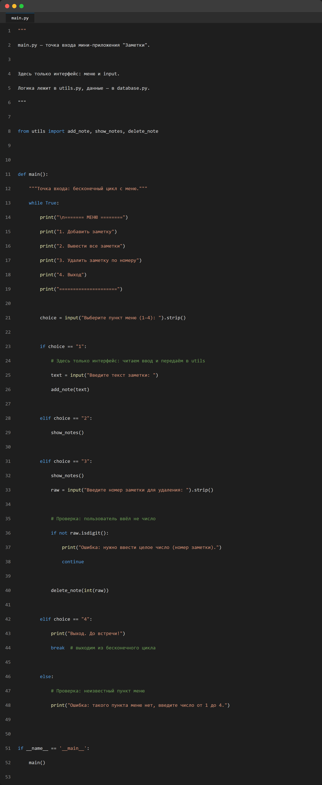
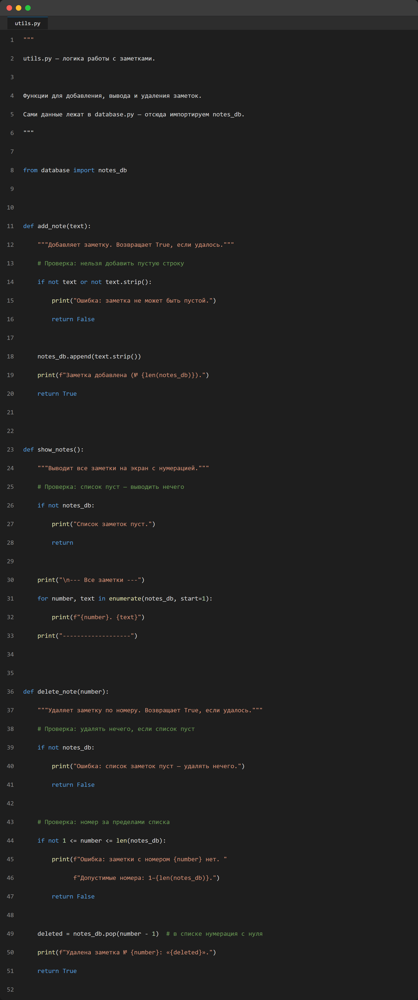
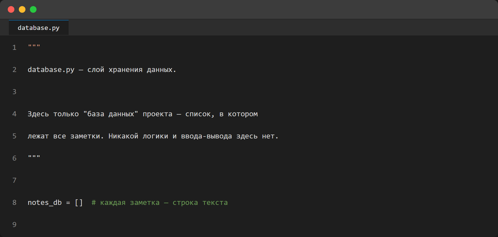
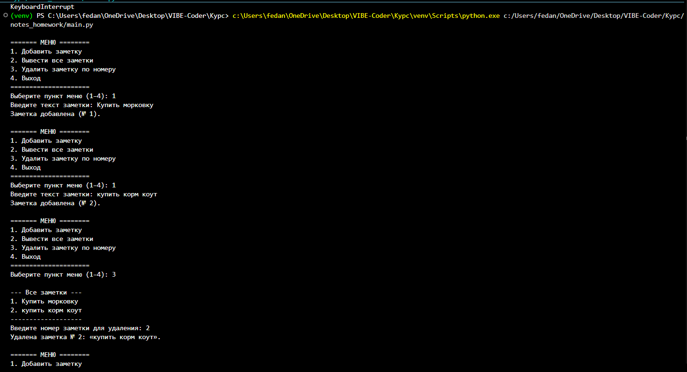
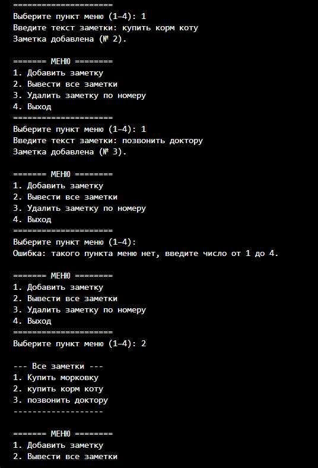

# ДЗ № 08 — От монолита к модулю: «Менеджер заметок» (notes_homework)

Проект: `notes_homework` (папка проекта в репозитории рядом с отчётом).
Скриншоты: папка `screenshots` рядом с отчётом (`../screenshots/homework_08_notes/`).

Конечное состояние — **модульное мини-приложение из трёх файлов** (`python main.py`); история развития: v1 — монолитный скрипт `notes.py` (всё в одном файле), v2 — разрез на слои «данные / логика / интерфейс». Обе версии оставлены в папке проекта: `notes.py` — для сравнения, `main.py` — для проверки.

---

## 1. Идея и постановка задачи

**Задача из ДЗ (этап 1).** Написать монолитный скрипт `notes.py` — всё в одном файле. Скрипт работает в бесконечном цикле с меню в терминале:

1. Добавить заметку (строку текста) в список.
2. Вывести все заметки на экран.
3. Удалить заметку по номеру.
4. Выход.

Требования к качеству: чистый код с комментариями, проверки на ошибки (не число при удалении, пустой список и т. п.).

**Задача из ДЗ (этап 2).** Перестроить проект в модульное мини-приложение из трёх файлов:

- `database.py` — только список для хранения данных (`notes_db = []`);
- `utils.py` — функции добавления, вывода и удаления; в файле импортируется `notes_db` из `database.py`;
- `main.py` — точка входа: только меню и `input`; функции импортируются из `utils.py`;
- обязательна конструкция `if __name__ == '__main__':` в `main.py`;
- импорты должны работать корректно, запуск — без ошибок.

**Смысл упражнения.** Не в меню и не в заметках, а в том, чтобы прожить переход «монолит → модули» руками: увидеть, где код естественно делится на слои, и поймать главную ловушку Python-импортов — чем `from database import notes_db` отличается от владения «своей» копией списка.

---

## 2. Стек и ограничения

| Компонент | Что и зачем |
|---|---|
| Python 3 (стандартная библиотека) | консольный интерфейс и логика; внешних зависимостей нет |
| `list` в памяти | хранилище заметок; данные не переживают перезапуск — так по ТЗ |
| PowerShell pipe | проверка: реальный ввод подаётся в stdin скрипта, вывод сверяется построчно |

Сознательные ограничения (по ТЗ): заметка — строка, хранение в памяти, никакого файла, никаких тестовых фреймворков.

---

## 3. Этап 1 — монолит (`notes.py`)

### Что внутри

Один файл, пять функций: `add_note()`, `show_notes()`, `delete_note()` и меню-цикл `main()`. Список `notes = []` объявлен на уровне модуля. Все проверки прописаны явно:

| Ситуация | Реакция |
|---|---|
| Пустая строка при добавлении (`not text`) | «Заметка не может быть пустой» |
| Буквы вместо номера (`raw.isdigit()`) | «Нужно ввести целое число» |
| Номер вне диапазона `1..len(notes)` | Сообщение с допустимыми номерами |
| Удаление при пустом списке | «Список заметок пуст — удалять нечего» |
| Просмотр пустого списка | «Список заметок пуст» |
| Неизвестный пункт меню | «Введите число от 1 до 4» |

### Проверка

Интерактивный запуск под моим терминалом не показал проблему, а проверка через подставленный ввод (`"..." | python notes_homework\notes.py`) прогнала все ветки: добавление, вывод, удаление, ввод букв вместо номера, несуществующий номер, выход. Фрагмент реального прогона:

```text
Выберите пункт меню (1–4): 
--- Все заметки ---
1. Вторая заметка
-------------------
Введите номер заметки для удаления: Ошибка: нужно ввести целое число (номер заметки).
...
Введите номер заметки для удаления: Ошибка: заметки с номером 99 нет. Допустимые номера: 1–1.
...
Введите номер заметки для удаления: Удалена заметка № 1: «Вторая заметка».
...
Выберите пункт меню (1–4): Выход. До встречи!
```

Нюанс, проявившийся при проверке через pipe: у PowerShell подводная кодировка кириллицы сдвигает подставляемые строки (строка с текстом попадает на пункт меню и даёт «Ошибка: такого пункта меню нет» ещё до начала сценария). Логика от этого не ломается, но финальный сценарий удобнее гонять вводом без кириллицы — так и сделал во второй проверке. Это не баг приложения, а свойство перенаправления ввода в консоли Windows; в интерактивном режиме ничего такого нет.

---

## 4. Этап 2 — разрез на модули

### Как делил

Разделение сделал по слоям, а не «порезал файл на три части». Критерий: в каждом файле — свой уровень ответственности.

| Файл | Слой | Что содержит | Чего в нём нет |
|---|---|---|---|
| `database.py` | Данные | `notes_db = []` — и всё | Никакой логики, никакого ввода-вывода |
| `utils.py` | Логика | `add_note(text)`, `show_notes()`, `delete_note(number)` + проверки | Нет `input()` — функции принимают готовые данные и возвращают `True`/`False` |
| `main.py` | Интерфейс | Меню-цикл, `input`, `if __name__ == '__main__':` | Нет работы со списком напрямую |

### Два решения, которые пришлось принимать

**1. Кому отдать проверку «не число».** Проверка ввода — на стыке слоёв. Решение: разбор ввода пользователя (`isdigit()`) остался в `main.py` — это часть интерфейса, парсинг того, что ввёл человек; проверки смысла (пустой список, диапазон) — в `utils.py`. Функция `delete_note(number)` принимает уже готовое целое, а не сырую строку.

**2. Сигнатуры функций.** В монолите функции читали ввод сами (`input()` внутри). При разрезе это в первую очередь пришлось развязать: `add_note(text)` теперь принимает текст параметром и возвращает `True`/`False`. Интерфейс и логика перестали быть сцеплены с терминалом — «бесплатный» побочный эффект модульности: логика стала проверяемой без ввода с клавиатуры.

### Проверка корректности импортов

Ключевая проверка по ТЗ — импорты работают и обе части программы видят **один и тот же** список, а не свои копии:

```text
python -c "import database, utils; utils.add_note('sample'); ..."
database.notes_db: []
Заметка добавлена (№ 1).
utils sees same db: True
```

`utils.notes_db is database.notes_db → True` — это и есть тот момент, ради которого упражнение делается: `from database import notes_db` импортирует **ссылку** на один-единственный список, поэтому добавление через `utils.add_note()` видно и в `database.notes_db`. Связка бы распалась, если бы каждый модуль создавал собственный список или переприсваивал имя (`notes_db = []` заново); append через методы списка безопасен именно потому, что мутирует общий объект по месту, не создавая нового.

### Полный прогон меню

`"... " | python notes_homework\main.py` — все ветки снова пройдены на модульной версии:

```text
Выберите пункт меню (1–4): Список заметок пуст.
...
Выберите пункт меню (1–4): Ошибка: список заметок пуст — удалять нечего.
...
Выберите пункт меню (1–4): Введите текст заметки: Заметка добавлена (№ 1).
...
--- Все заметки ---
1. test note
-------------------
Введите номер заметки для удаления: Удалена заметка № 1: «test note».
...
Выберите пункт меню (1–4): Выход. До встречи!
```

---

## 4.1. Демонстрация работы (скриншоты)

Скриншоты сняты по требованию ДЗ: код трёх модулей и работа программы в терминале. Код показан как есть, без сокращений; кадры терминала — реальный интерактивный запуск `python main.py`.

**1. Код `main.py` — точка входа.** Только интерфейс: меню-цикл, `input`, разбор ввода, вызовы функций из `utils.py` и завершение через `if __name__ == '__main__':`.



**2. Код `utils.py` — логика.** Импорт `notes_db` из `database.py` (строка 8) и три функции: `add_note` с проверкой пустой строки, `show_notes` с сообщением для пустого списка, `delete_note` с проверками пустого списка и диапазона номера.



**3. Код `database.py` — хранение.** Ровно один список `notes_db = []`, никакой логики и ввода-вывода (по ТЗ хранение допустимо в списке или JSON-файле — выбран список).



**4. Работа программы в терминале — кадр 1: запуск, добавление и удаление.** Видна команда запуска из venv (`venv\Scripts\python.exe ...\notes_homework\main.py`); добавлены «Купить морковку» и «купить корм коту» (№ 1 и № 2), затем удаление: по пункту 3 показывается список, вводится номер 2 — удаляется «купить корм коту».




**5. Работа программы в терминале — кадр 2: добавление, вывод и ошибка меню.** Продолжение работы: заметки «купить корм коту» (№ 2) и «позвонить доктору» (№ 3) добавлены; на неизвестном пункте меню приложение не падает, а сообщает «введите число от 1 до 4»; по пункту 2 выводится полный список из трёх заметок.



Съёмка повторяемая: скрипт `make_screenshots.py` рядом с отчётом строит страницы с кодом и сессией и снимает их headless Chromium'ом (playwright) — так же, как в ДЗ № 07.

---

### 5.1. Монолит

**Вход:** ТЗ (меню из 4 пунктов, бесконечный цикл, проверки).
**Что сделал:** один файл со структурированием по функциям сразу — внутри монолита всё равно завёл `add_note`/`show_notes`/`delete_note`, а не свалил в `main()`. Это и подготовило почву для этапа 2: разрез потом прошёл почти без переписывания.
**Выход:** `notes.py`, все ветки проверены.

### 5.2. Разрез на модули

**Вход:** пользовательское ТЗ по трём файлам с указанием, что в каком лежит.
**Что сделал:** `database.py` (список), `utils.py` (логика + `from database import notes_db`), `main.py` (интерфейс + `if __name__ == '__main__':`); развязал функции от `input()`; проверки разложил по слоям (см. раздел 4).
**Сложность:** решить, где живёт проверка «не число» — в логике или в интерфейсе. Решил, что разбор сырого ввода — интерфейс, смысловые проверки — логика.
**Выход:** три файла, прогоны меню и импортов без ошибок.

### 5.3. Проверка и фиксация

**Что сделал:** два прогона через pipe (все ветки меню, включая полный сценарий для скриншота), отдельная проверка тождества списка через `python -c`, README в стиле остальных проектов курса, четыре скриншота по требованию ДЗ (код трёх файлов + работа терминала).

---

## 6. Что сделано по-своему

- **Разрез по слоям, не по механике**: `database.py` не «хвост» монолита, а настоящая граница — в нём нет ни логики, ни ввода-вывода.
- **Функции логики отсоединены от терминала**: принимают данные параметрами, сигнализируют `True`/`False` — интерфейс решает, что показывать.
- **Проверка «список общий, а не копия»** — через `is`, а не на глаз: сравнение тождества объектов прямо доказывает, что модульный проект держит одно хранилище.
- **Монолит не выброшен**: `notes.py` оставлен рядом как вариант «до» — историю изменения полезно держать в проекте, а не только в git.

---

## 7. Тестирование

Автоматических тестов нет (не по ТЗ). Проверено вручную, два уровня:

1. **Функциональный (E2E меню):** подставленный ввод через pipe на обеих версиях — все 4 пункта меню, все 6 веток ошибок, корректный выход.
2. **Импортный:** отдельный `python -c` — импорт обоих модулей без побочных эффектов, добавление через `utils`, тождество `utils.notes_db is database.notes_db → True`.

**Честно не покрыто:** ввод с реальной клавиатуры (проверял сужением ввода через pipe); поведение при `Ctrl+C` и нестандартных прерываниях.

---

## 8. Личный вывод

Самое полезное открытие упражнения — **импорт — это связь, а не копирование**. Пока список был в том же файле, о разнице «имя → объект» и «имя → копия объекта» думать не приходилось. После разреза вопрос «а увидит ли `database.py` то, что добавил `utils`?» оказался реальным, и проверка через `is` — не педантизм, а самый короткий способ закрыть его.

Второй вывод — **границу слоя надо решать, а не угадывать**. Проверка `isdigit()` выглядит «логикой», но по смыслу это разбор пользовательского ввода, и она осталась в интерфейсе. Границу между интерфейсом и логикой провёл не по формальному признаку («тут есть input»), а по вопросу «кто отвечает за смысл, а кто за доставку данных».

Третий — **монолит, написанный аккуратно, режется дёшево**. Функции уже были выделены на этапе 1, поэтому модульная версия — в основном «переехала», а не переписалась. Это дешёвая инвестиция, которая окупилась на втором же этапе.

---

## 9. Известные ограничения и чего не хватает

- Заметки живут в памяти и теряются при выходе (по ТЗ).
- Только текстовые заметки: без дат, тегов, поиска.
- `isdigit()` не принимает отрицательные числа и пробелы вокруг («  1  » — ошибка, хотя человек имел в виду `1`).
- Автотесты на `utils.py` не написаны (функции к тому уже готовы — это первый пункт развития).

## 10. Возможности развития

1. Сохранение `notes_db` в JSON-файл при выходе и загрузка при старте (естественное расширение слоя `database.py`).
2. Автотесты функций логики (теперь они принимают данные параметрами — тестируются без ввода с клавиатуры).
3. Поиск и редактирование заметок.
4. Разрушение цикла с `match/case` и отдельный слой «представление» если пунктов меню станет много.
