# ДЗ № 10 — TEAM TASK MANAGER: Telegram-бот управления задачами команды (team_task_manager)

Проект: `team_task_manager` (папка проекта в репозитории; исходное ТЗ — `Промпт.docx`,
извлечённый текст — `prompt_extracted.txt`).
Скриншоты: папка `../screenshots/homework_10_team_task/` (часть снята скриптом
`make_screenshots.py` рядом с отчётом, часть — живые скриншоты чата Telegram).

Конечное состояние — **работающий Telegram-бот: 8 команд, 55 автотестов (55/55),
экспорт CSV/XLSX документом, роли ADMIN/MEMBER, настраиваемые справочники**.
Проект прошёл живую приёмку в Telegram (этапы «экспорт» и «навигация» приняты
заказчиком письменно) и отправлен на GitHub
([коммит финализации](https://github.com/MarfaVass/VibeCodelession/commit/482c5aa2d33614af63d6bd04a42889472ad213e1)).

---

## 1. Идея и постановка задачи

Задание — полноценный проект-система (не упражнение): **Telegram Task Manager
для командной работы** по подробному ТЗ (`Промпт.docx`, 439 абзацев).

Ключевые требования ТЗ:

1. **Назначение** — сбор, распределение и контроль задач одной команды/организации.
   Бизнес-специфика (категории, статусы, приоритеты) не зашивается в код —
   настраивается администратором через интерфейс.
2. **Стек**: Python, aiogram 3.x, SQLite, aiosqlite, openpyxl, python-dotenv,
   logging, pytest (+ pytest-asyncio). Зависимости — только в venv, версии
   фиксируются в requirements.txt.
3. **Обязательные команды**: `/start`, `/add`, `/list`, `/list_csv`;
   дополнительные: `/my`, `/stats`, `/export_excel`, `/help`.
4. **БД**: таблицы tasks, users, categories, statuses, priorities,
   task_history, settings (+ доп.); UTC-хранение, отображение с учётом
   TIMEZONE; внешние ключи, индексы, транзакции, версионирование схемы.
5. **Роли**: ADMIN (полное управление, справочники, удаление) и MEMBER
   (создание, свои задачи); первый админ — из ADMIN_IDS; проверки прав —
   на серверной стороне в каждом обработчике, а не только скрытием кнопок.
6. **Экспорт**: CSV (UTF-8 BOM, разделитель «;», русские заголовки) и
   настоящий XLSX из трёх листов (ЗАДАЧИ / СВОДКА / СПРАВОЧНИКИ) с
   оформлением, формулами, автофильтрами, закреплением шапки.
7. **Инфраструктура**: FSM-ввод с отменой и очисткой состояний, уведомления
   с защитой от повторов, логирование с ротацией, резервное копирование
   штатным SQLite backup, миграции, тесты на отдельной тестовой БД.
8. **Порядок работы**: поэтапно (9 этапов), на каждом — проверки и отчёт;
   «не заменять полную реализацию заглушками».

## 2. Стек и ограничения

| Компонент | Версия | Зачем |
|---|---|---|
| Python | 3.12.10 | основной язык (проверено 3.10–3.13) |
| aiogram | 3.32.0 | Telegram Bot API, FSM, роутеры, middleware |
| aiosqlite | 0.22.1 | асинхронная работа с SQLite |
| openpyxl | 3.1.5 | настоящий XLSX с формулами и оформлением |
| python-dotenv | 1.2.4 | конфигурация через .env |
| tzdata | 2026.6 | базы часовых поясов (без него Windows не знает даже UTC) |
| pytest / pytest-asyncio | 9.2.0 / 1.5.0 | автотесты, 55 штук |

Сознательные ограничения ТЗ: **нет** PostgreSQL, Docker, веб-панели,
Google Sheets, двусторонней синхронизации с Excel. SQLite — единственный
источник истины; экспорт — снимок на момент выгрузки.

## 3. Архитектура

```
main.py                 → точка входа: настройки, БД, меню команд, polling
app/
├── config/  settings.py    — чтение .env (BOT_TOKEN не попадает в код/логи)
├── database/ database.py   — aiosqlite-обёртка: транзакции, fetch-хелперы, SQL-функция ufold()
│             migrations.py — версионирование схемы (v1 — все 8 таблиц)
│             repositories/ — SQL-слой: tasks, users, settings
├── services/ task_service.py        — бизнес-правила (can_* проверка прав, история)
│             statistics_service.py — агрегаты из SQLite без синтетики
│             notification_service.py — уведомления с дедупликацией по ключу
│             backup_service.py     — SQLite backup API, ротация до 15 копий
├── handlers/ 8 роутеров     — start, help, tasks (FSM), task_management, lists,
│                             statistics, exports, admin
├── keyboards/ 3 модуля      — главное меню, карточки/FSM, админ-раздел
├── states/    task_states.py — AddTaskStates (6 шагов), ValueInputStates (purpose)
├── middlewares/ access_control.py — регистрация пользователя + блокировка неактивных
├── exports/   csv_export.py, excel_export.py
└── utils/     dates.py (UTC↔местное), logger.py (ротация 5 МБ × 5), validators.py
```

Контракты callback-данных (все короче 64 байт): `menu:*`, `dir:*`, `stp:*`,
`conf:*`, `list:<фильтр>:<страница>`, `task:<id>`, `tst/tpr/tas:<id>:<знач>`,
`ted:<поле>:<id>`, `tdel:<id>`/`tdel:yes:<id>`, `this:<id>`, `flt:*`, `exp:*`,
`adm:*`, `ref*`, `usr*`, `fsm:cancel`.

## 4. Что сделано по-своему (ключевые решения)

- **Unicode-поиск кириллицы.** Встроенный LIKE SQLite сворачивает регистр
  только для ASCII — «договор» не находил «Договор аренды». Решение: на каждое
  соединение регистрируется SQL-функция `ufold()` (обёртка `str.casefold`),
  поиск — `ufold(t.title) LIKE ?` — фильтрация осталась в SQL **до** LIMIT/OFFSET,
  поэтому пагинация и COUNT корректны. Проверено интеграционным сценарием:
  17 задач, смешанный регистр, фильтр+страница без пересечений.

- **Экспорт из меню.** Претензия «содержимое копируется в буфер» не
  воспроизводилась в коде: отправка документом (`FSInputFile` +
  `answer_document`) уже была. Реальная проблема UX: в меню «📤 Экспорт» боту
  предлагалось набрать команду вручную. Добавлены кнопки «📄 Скачать CSV» /
  «📊 Скачать Excel» (`exp:csv`/`exp:xlsx`) поверх единого helper
  `_build_and_send()` — команды (`/list_csv`, `/export_excel`) делегируют в
  него же, логика не задублирована.

- **Управляемая очистка FSM** (`helpers.leave_scenario()`): переход в главное
  меню стирает активный сценарий и временные данные (черновик создания,
  purpose редактирования), но восстанавливает только навигационные
  (`last_list`, `search_text`) — следующий текст не перехватывается старым
  сценарием, а результаты поиска переживают возврат в меню (пагинация
  поиска продолжает работать).

- **Контекст списков.** `_render_list` записывает `last_list=filter_key:page`
  при каждом рендере; карточка задачи строит кнопку «⬅️ К списку» по нему —
  возврат в тот же фильтр и страницу, из которых карточка открыта. Некорректный
  контекст → безопасный fallback `list:all:0`.

- **Меню команд бота** (`set_my_commands` из 8 команд при старте) — Telegram
  не заполняет меню «/» сам; до этого списка команд возле поля ввода не было.

- **Настройка часовых поясов**: даты в БД — UTC ISO; отображение — через
  `TIMEZONE` (Asia/Moscow). Дедлайн хранится как конец местного дня,
  переведённый в UTC, поэтому «просрочено» считается правильно.

## 5. Живая отладка (что вскрывается только в бою)

Самые поучительные находки этапа живой проверки:

1. **Вебхук чужой платформы.** Первый запуск упёрся в `TelegramConflictError`:
   getUpdates не работает, пока на токене активен вебхук. `getWebhookInfo`
   показал `chatter.salebot.pro` — токен когда-то подключали к конструктору
   чат-ботов. После согласованного удаления вебхука polling заработал. Дефект
   не в коде — но его невозможно отладить без лога и API-диагностики.
2. **Первый контакт нового участника.** На первом же реальном `/start` —
   `TypeError: 'NoneType' object is not subscriptable` в middleware:
   `ensure_registered()` при **первой регистрации** выполнял INSERT, но
   не перечитывал пользователя и возвращал `None`. Юнит-тесты не ловили:
   фикстуры всегда делали `get()` сами после вызова. Исправление — 2 строки
   (перечитка после INSERT) + отдельная проверка двух веток.
3. **Пустое меню команд.** Пользователь сразу заметил: разделов в меню «/» нет —
   приложение никогда не вызывало `set_my_commands`. Добавлено при старте,
   сбой установки не блокирует запуск.
4. **Сетевой разрыв во время простоя.** Бот простоял ~6.5 часа; при
   недоступности api.telegram.org штатно закрылся с `CRITICAL` в логе,
   после восстановления связи перезапуск без потерь данных (WAL + миграции).

Все пять задокументированы в логе и зафиксированы в отчёте проекта
(`reports/final_project_report.md` §8 внутри папки проекта).

## 6. Этапы работы (Вход → Что сделал → Выход)

### 6.1. Окружение и БД
**Вход:** ТЗ на структуру и схему. **Что сделал:** venv, зафиксированные
версии, миграция v1 (8 таблиц, индексы, seed-справочники из ТЗ), PRAGMA
foreign_keys/WAL, транзакции с rollback. **Выход:** структура совпадает с ТЗ
посимвольно; тесты database (8) зелёные.

### 6.2. MVP и расширения (этапы 3–7 ТЗ)
**Вход:** обязательные и дополнительные команды. **Что сделал:** FSM-создание
с пропуском необязательных полей, карточки с историей, фильтры/поиск/пагинация,
роли с серверными проверками, справочники с безопасным отключением,
уведомления с дедупликацией. **Выход:** все команды ТЗ работают.

### 6.3. Экспорт (этап 6 ТЗ + этап приёмки)
**Вход:** CSV для Excel-русской локали, XLSX трёх листов с формулами.
**Что сделал:** UTF-8 BOM через `utf-8-sig`; СВОДКА на живых формулах
(COUNTA/COUNTIF) — снимок базы, не интерфейс редактирования; приёмка через
меню (см. §4). **Выход:** 16 тестов экспорта и обработчиков экспорта.

### 6.4. Навигация (этап приёмки 2)
**Вход:** «из карточки нет выхода в меню», «возврат теряет фильтр», «FSM
застревает». **Что сделал:** §4 (контекст списков, leave_scenario), футеры
«Назад/К карточке/Главное меню», тупики админ-справочников (ошибка ввода —
с кнопкой «Отмена», успех — возврат в список справочника). **Выход:** 16
тестов навигации; письменная приёмка заказчиком.

### 6.5. Тестирование и документация (этап 9)
**Вход:** требование «все тесты должны проходить до объявления проекта
готовым». **Что сделал:** 55 тестов на временной БД (tmp_path) и настоящем
aiogram FSMContext; контрольная проверка финализации: сборка диспетчера из
8 роутеров (14 message + 44 callback-обработчика), миграции на свежей БД
(версия 1, все таблицы, foreign_key_check OK, WAL), скан секретов в staged
файлах. **Выход:** README (полная инструкция развертывания), BACKLOG.md,
отчёт проекта.

## 7. Демонстрация (скриншоты)

**Структура и код** (сняты скриптом `make_screenshots.py` — headless Chromium):

1. Структура проекта целиком (главное окно проводника).
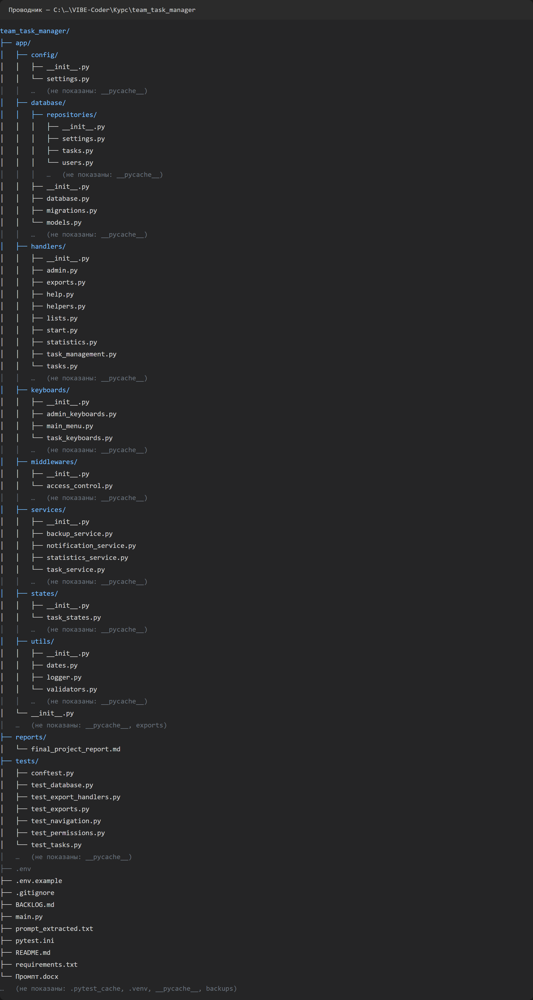
2. `main.py` — точка входа: сборка диспетчера, роутеры, middleware доступа, polling с backoff.
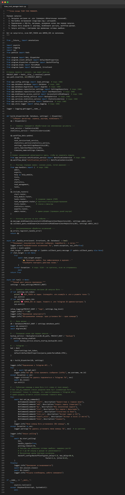
3. Экспорт: единый helper `_build_and_send` и кнопки меню (`exp:csv`/`exp:xlsx`).
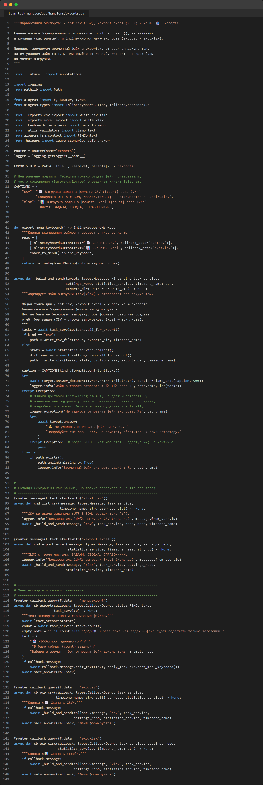
4. Навигация: контекст списков и управляемая очистка FSM (`leave_scenario`).
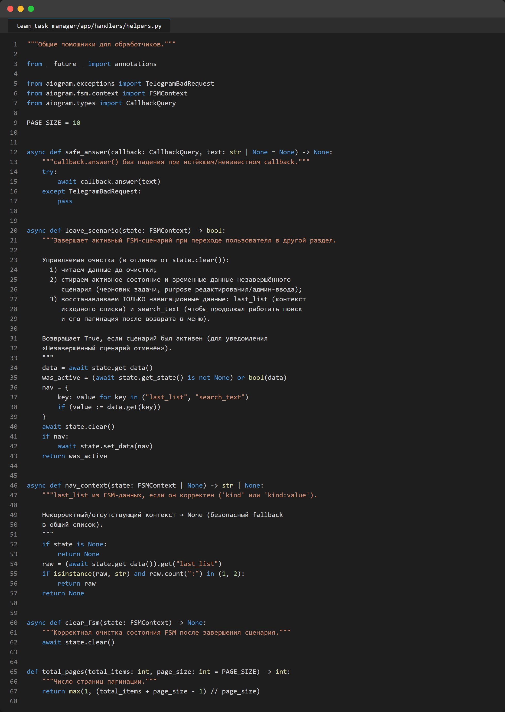

**Реальные прогоны** (терминал и журнал — сняты со значений, как они есть):
5. `pytest -q` — полная финиширующая сессия: 55 passed.
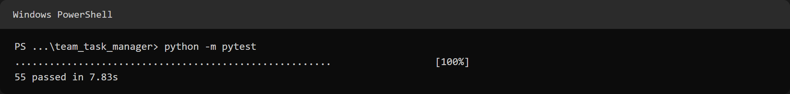
6. Фрагмент журнала бота: регистрация участника, создание задач, обработка обновлений.
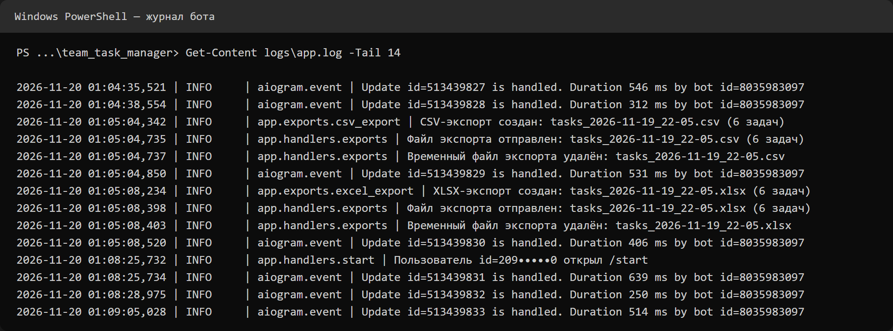

**Живой Telegram** (скриншоты из реальной работы бота — сняты заказчиком
и переданы в папку скриншотов; персональных данных в кадрах нет:

6. `/start` — приветствие и главное меню (для администратора — с «⚙️ Админ-панель»).
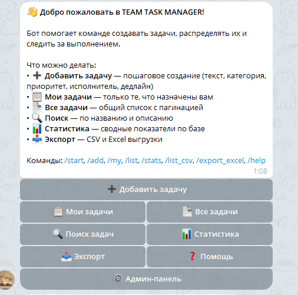

7. «Все задачи» — список с пагинацией: 6 задач, статус/ID/название, кнопка «⬅️ В меню».
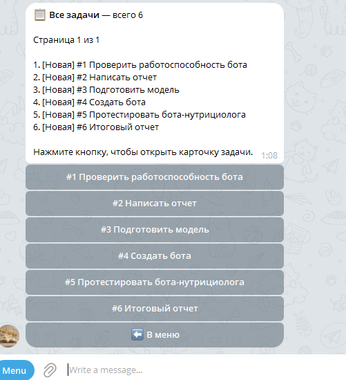

8. FSM-создание задачи: шаг 1 — название, шаг 2 — описание, шаг 3 — категория;
   видны кнопки «Пропустить»/«Отмена» и уведомление «✖️ Незавершенный сценарий
   отменен» после возврата в меню из незаконченного сценария (этап навигации в деле).
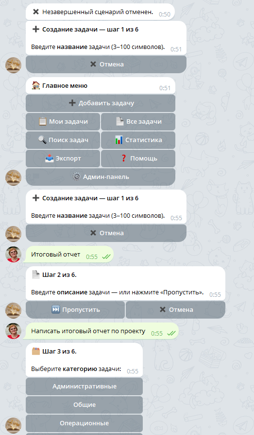

9. Меню «📤 Экспорт данных» с кнопками «📄 Скачать CSV» / «📊 Скачать Excel»
   (этап 1) — под ним два полученных документа: `tasks_…csv` (1,4 КБ) и
   `tasks_…xlsx` (8,8 КБ) с нейтральными подписями.
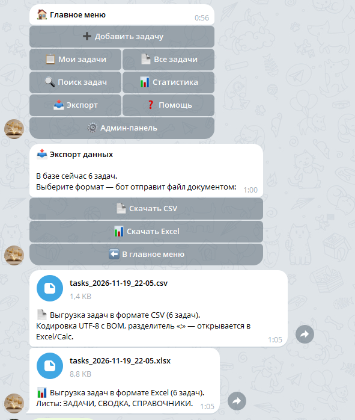

10. Открытый `tasks_….csv` в Excel: кириллица читается без «кракозябр»
    (UTF-8 BOM, разделитель «;»), 12 колонок с датами в формате ДД.ММ.ГГГГ ЧЧ:ММ.
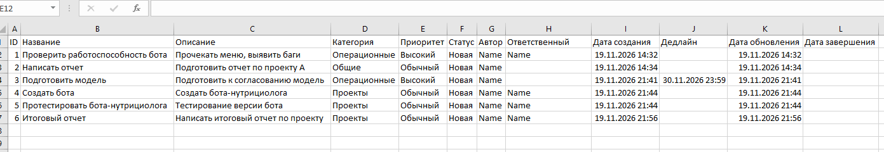

11. Открытый `tasks_….xlsx` в Excel: лист ЗАДАЧИ с оформлением — синяя шапка,
    автофильтр, цветовая индикация приоритета («Высокий» залит), выделение дат.
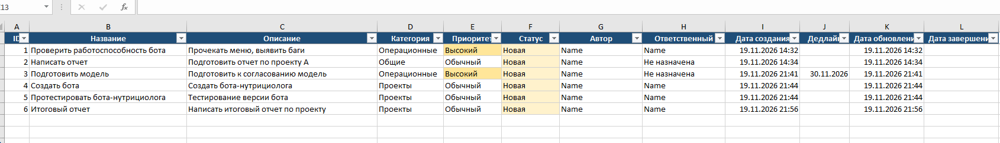

## 8. Тестирование

**Автотесты (55/55 passed, pytest 9.2)**:

| Модуль | Тестов | Покрывает |
|---|---|---|
| test_database | 8 | миграции, FK, WAL, rollback, переживание перезапуска, seed |
| test_tasks | 9 | создание, сортировка, фильтры, Unicode-поиск+пагинация, статусы/история |
| test_permissions | 6 | роли, активность, can_delete, проверка активности исполнителя |
| test_exports | 8 | CSV BOM/экранирование, XLSX 3 листа, сводка-числа, пустая база, «экспорт — снимок» |
| test_export_handlers | 8 | документ через answer_document, удаление temp-файлов при успехе/ошибке, пустая база документом |
| test_navigation | 16 | контекст списков, FSM-очистка с сохранением поиска, подтягивания админ-FSM |

Тесты работают с **временной БД в каталоге ОС** — рабочая база недостижима
из тестов архитектурно (фикстуры создают Database на tmp_path).

**Живые проверки (ручные, подтверждены заказчиком):** этап «экспорт» (документы
CSV/XLSX приходят в чат) и этап «навигация» (возвраты, отмена сценариев) —
приняты; `/start`, создание задач, обновления обрабатываются журналом без ошибок.

## 9. Личный вывод

1. **Проект-ТЗ ≠ упражнение: главная работа начинается после «зелёных тестов».**
   Все 55 тестов проходили, а первый реальный `/start` упал. Строки кода,
   которые тесты не достают (фикстуры всегда докидывали недостающее сами),
   вскрываются только настоящим пользователем с настоящим Telegram. Отсюда
   правило: фикстура не должна полностью «сглаживать» контракт метода.
2. **Причину пользовательской жалобы надо искать в коде, а не в описании.**
   «Содержимое копируется в буфер обмена» не подтверждалось ни кодом, ни
   логом — реальная проблема была в UX меню (экспорт из кнопок недоступен).
   Диагностика через API (`getWebhookInfo`, `get_my_commands`) даёт факты
   вместо догадок: так же найден вебхук Salebot и пустое меню команд.
3. **Состояние FSM — это навигация, а не только сценарий.** Пока FSM был
   «внутри» сценариев, кнопки навигации и сценарии жили параллельно и
   конфликтовали. Управляемая очистка (сохранить поиск, стереть черновик)
   превратила два независимых механизма в один: меню — оператор над FSM.
4. **Миграции и WAL окупились на первом же сбое.** Простой машины с сетевым
   разрывом привёл к штатному завершению и перезапуску без потерь — ровно
   для этого ТЗ требовало UTC-хранения, WAL и транзакций.

## 10. Известные ограничения

- Цветовая индикация XLSX привязана к «стандартным» названиям статусов/приоритетов
  (осознанная семантика: нестандартные названия — без заливки).
- «Отменённый» статус семантически определяется по названию в счётчике
  «выполнено» (`CANCELLED_STATUS_NAME`) — вынос в настройку зафиксирован для
  дашборда (BACKLOG).
- Статистика — текстовая; дашборд с вкладками и периодами перенесён в BACKLOG.
- Экспорт — снимок; обратного импорта из файлов нет (вне ТЗ).
- `schedule_deadline_reminder()` — точка расширения без механики (напоминания
  о дедлайнах не реализованы).

## 11. Возможности развития

### 11.1. Зафиксировано в BACKLOG.md (согласовано)

Развитие административной панели; интерактивный календарь дедлайнов;
аналитический дашборд (вкладки «Обзор»/«Динамика»/«Нагрузка», периоды
сегодня/7/30 дней/всё время, ADMIN/MEMBER-scope на уровне запросов, учёт
отменённых задач через настройку, часовой пояс Asia/Moscow, совместимость
с Excel-экспортом).

### 11.2. Обсуждённые кандидаты сверх BACKLOG (21.11.2026)

Направления и допущения, предложенные и принятые к фиксации как кандидаты
(реализация каждого — отдельное согласование; ничего из этого не входит в
сделанную ДЗ).

**Дедлайны и время**

| # | Расширение | Ценность | Сложность | Комментарий |
|---|---|---|---|---|
| 1 | Напоминания о дедлайнах | ⭐⭐⭐ | низкая/средняя | точка расширения уже в коде (`schedule_deadline_reminder`), дедупликация готова; нужен фоновый планировщик |
| 2 | Утренний дайджест «твои задачи на сегодня» | ⭐⭐ | средняя | нужен планировщик (apscheduler или asyncio-цикл) |
| 3 | Эскалация просрочек админу (ежедневная сводка) | ⭐⭐ | низкая | поверх готовой статистики |

**Работа с задачами**

| # | Расширение | Ценность | Сложность | Комментарий |
|---|---|---|---|---|
| 4 | Комментарии к задачам | ⭐⭐⭐ | средняя | нужна миграция V2 (таблица comments), уведомления участникам |
| 5 | Вложения (фото/документы в карточку) | ⭐⭐ | средняя | хранение вне БД, ссылки в карточке |
| 6 | Шаблоны задач | ⭐⭐ | низкая/средняя | предзаполненные категория/приоритет/исполнитель |
| 7 | Сортировка списка по выбору (дедлайн/приоритет) | ⭐ | низкая | дёшево |
| 8 | Экспорт отфильтрованного списка | ⭐⭐ | низкая | из аудита этапа 1 |

**Обмен данными и интеграции**

| # | Расширение | Ценность | Сложность | Комментарий |
|---|---|---|---|---|
| 9 | Импорт из CSV/XLSX со валидацией | ⭐⭐ | средняя | обратный экспорту сценарий |
| 10 | ICS-экспорт дедлайнов (Google/Outlook) | ⭐⭐ | средняя | календарь-совместимый формат |
| 11 | Автоотправка резервных копий админу | ⭐⭐ | низкая | бот присылает свежий backup-файл по расписанию |

**Организация команды**

| # | Расширение | Ценность | Сложность | Комментарий |
|---|---|---|---|---|
| 12 | Код приглашения в команду | ⭐⭐ | средняя | сейчас писать боту может любой — ограничение состава и приватности |
| 13 | Уведомления в групповой чат команды | ⭐⭐ | средняя | события в общий чат |
| 14 | Подтверждение выполнения («на проверке» → согласование автором) | ⭐ | низкая/средняя | двухшаговый цикл закрытия |

Открытый вопрос, зафиксированный при обсуждении: идеи 1–3 требуют фонового
планировщика — либо новая зависимость `apscheduler`, либо «без новых
библиотек» (обычный asyncio-цикл менее элегантен, но зависимостей не добавляет).

