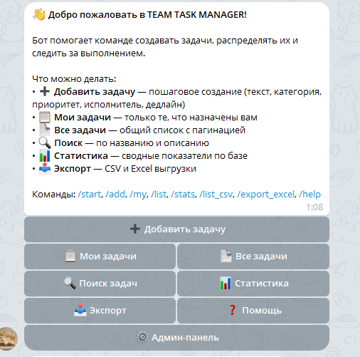
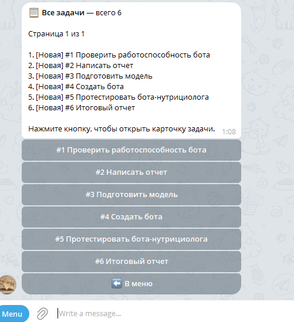
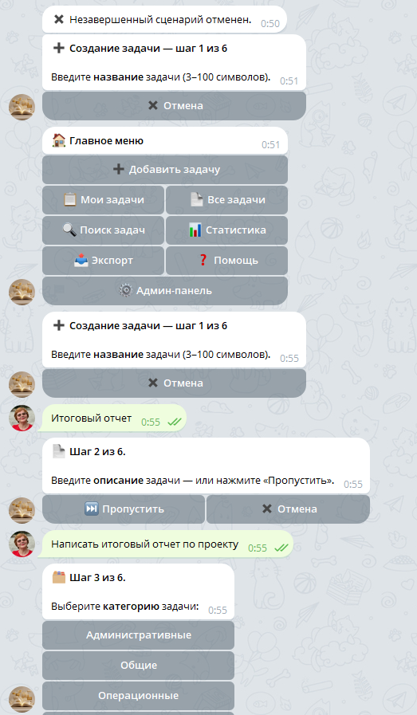
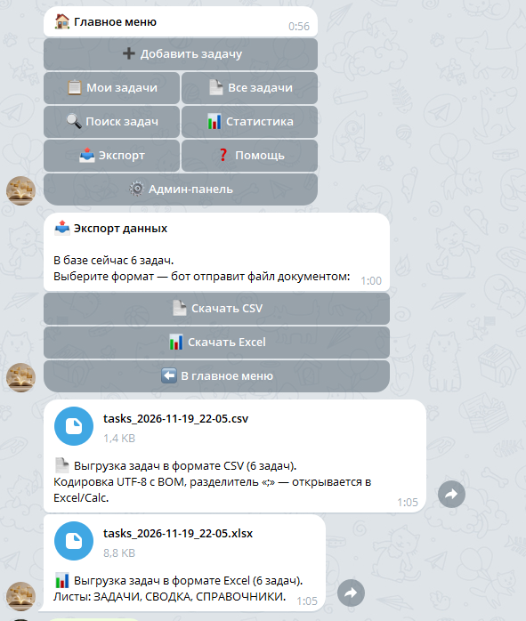
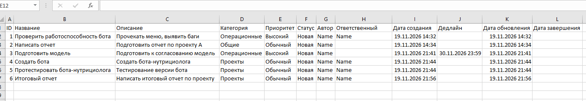
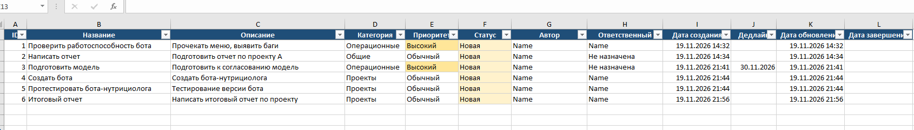

# TEAM TASK MANAGER

Telegram-бот для командной работы с задачами: создание, распределение,
контроль выполнения, статистика и экспорт в CSV/Excel.

Одна установка бота обслуживает **одну команду/организацию**. Бизнес-специфика
не зашита в код: категории, статусы, приоритеты и состав команды настраиваются
администратором через интерфейс бота.

---

## Возможности

| Раздел | Что умеет |
|---|---|
| Задачи | создание пошагово (FSM), карточка, редактирование, смена статуса/приоритета/исполнителя, удаление с резервной копией, **история изменений** |
| Просмотр | все задачи / мои задачи, фильтры (статус, категория, приоритет, просроченные, выполненные), **Unicode-поиск по кириллице** (`ufold`/casefold), **пагинация по 10 записей** |
| Навигация | из карточки — «⬅️ К списку» (с тем же фильтром и страницей) и «🏠 Главное меню»; незавершённые FSM-сценарии корректно отменяются при переходах |
| Роли | **ADMIN** — полное управление, справочники, удаление; **MEMBER** — создание задач, работа со своими назначенными задачами |
| Справочники | категории, статусы, приоритеты, участники — добавление, переименование, безопасное включение/отключение |
| Статистика | всего, по статусам, выполнено, просрочено, по категориям, по исполнителям — всё считается из SQLite |
| Экспорт | из команд **и из меню** («📄 Скачать CSV» / «📊 Скачать Excel»): CSV (UTF-8 BOM, «;») и XLSX с листами ЗАДАЧИ / СВОДКА / СПРАВОЧНИКИ |
| Надёжность | транзакции, внешние ключи, WAL, резервные копии SQLite (backup API), ротация логов, повтор при сетевых сбоях |

## Команды

```
/start         — приветствие и главное меню (завершает незавершённые сценарии)
/add           — создание задачи (пошагово: название → описание → категория →
                 приоритет → исполнитель → дедлайн → подтверждение)
/my            — мои назначенные задачи
/list          — все задачи с фильтрами (от старых к новым)
/list_csv      — экспорт всех задач в CSV
/export_excel  — экспорт в Excel (3 листа)
/stats         — статистика
/help          — справка
```

Экспорт также доступен через кнопки: главное меню → «📤 Экспорт» →
«📄 Скачать CSV» / «📊 Скачать Excel» — бот присылает файл документом
Telegram. Меню команд бота (кнопка «/») заполняется при старте автоматически.

## Требования

- Python **3.10–3.13** (проверено на 3.12.10)
- Аккаунт бота у [@BotFather](https://t.me/BotFather)

## Технологический стек

Python, aiogram 3.x, SQLite (aiosqlite), openpyxl, python-dotenv,
tzdata (базы часовых поясов на Windows), logging, pytest + pytest-asyncio.

## Структура проекта

```
team_task_manager/
├── main.py                  # точка входа: настройки, БД, меню команд, polling
├── requirements.txt         # зафиксированные версии зависимостей
├── pytest.ini               # конфигурация тестов
├── .env.example             # шаблон конфигурации (без секретов)
├── BACKLOG.md               # отложенные направления развития
├── Промпт.docx / prompt_extracted.txt  # исходное ТЗ проекта
│
├── app/
│   ├── config/settings.py   # чтение .env, объект Settings
│   ├── database/
│   │   ├── database.py      # соединение, транзакции, Unicode-функция ufold
│   │   ├── migrations.py    # версионирование схемы и миграции
│   │   ├── models.py        # dataclasses-модели
│   │   └── repositories/    # SQL-слой: tasks, users, settings
│   ├── services/            # бизнес-логика: task, statistics, notification, backup
│   ├── handlers/            # aiogram-обработчики: start, tasks, lists, exports, admin...
│   ├── keyboards/           # inline-клавиатуры (главное меню, карточки, дашборд-будущее)
│   ├── states/task_states.py# FSM-состояния
│   ├── middlewares/         # контроль доступа (роль, активность)
│   ├── exports/             # csv_export.py, excel_export.py
│   └── utils/               # даты (UTC), логгер, валидаторы
│
├── data/    # база SQLite (создаётся автоматически)
├── exports/ # временные файлы выгрузок (удаляются после отправки)
├── backups/ # резервные копии (до 15 последних)
├── logs/    # app.log с ротацией 5 МБ × 5 файлов
└── tests/   # pytest: БД, задачи, права, экспорт, обработчики экспорта, навигация
```

## Как создать бота (BotFather)

1. Откройте [@BotFather](https://t.me/BotFather) и отправьте `/newbot`.
2. Придумайте имя и username бота; BotFather выдаст **токен** вида
   `1234567890:AAH...` — он понадобится в `.env`.
3. Узнайте свой Telegram ID у бота [@userinfobot](https://t.me/userinfobot).

## Установка и запуск

```bash
# 1. Создать виртуальное окружение
python -m venv .venv

# 2. Активировать (Windows PowerShell)
.venv\Scripts\Activate.ps1

# 3. Установить зависимости
pip install -r requirements.txt

# 4. Создать .env из шаблона и заполнить
copy .env.example .env
#    BOT_TOKEN=токен от BotFather
#    ADMIN_IDS=ваш Telegram ID (можно несколько через запятую)

# 5. Запустить бота
python main.py
```

Первый администратор автоматически получает роль ADMIN из списка `ADMIN_IDS`
при первом сообщении боту. Остальные участники регистрируются как MEMBER
при первом контакте и получают доступ — их видит и управляет ими админ
в разделе «⚙️ Админ-панель» → «👥 Управление командой».

> **Если бот уже подключён к другой платформе через вебхук** (например, к
> внешнему конструктору чат-ботов), polling не сможет работать: Telegram
> вернёт `Conflict: can't use getUpdates method while webhook is active`.
> Остановите вебхук (`deleteWebhook`) или используйте другой токен.

## Файл .env

```
BOT_TOKEN=          # токен бота (обязательно)
ADMIN_IDS=          # Telegram ID администраторов через запятую (обязательно)
TIMEZONE=Europe/Stockholm   # пояс отображения дат (пример: Asia/Moscow)
DATABASE_PATH=data/tasks.db
LOG_LEVEL=INFO
BACKUP_ENABLED=true
```

Файл `.env` исключён из Git (`.gitignore`). Никогда не публикуйте токен.

## База данных (SQLite)

Таблицы: `users` (id = Telegram ID, роль, активность), `categories`,
`statuses` (флаги `sort_order`, `is_final`), `priorities`, `tasks`
(ссылки на справочники, дедлайн, даты создания/обновления/завершения),
`task_history` (кто, что, старое/новое значение), `settings` (в т.ч.
версия схемы SCHEMA_VERSION), `notifications` (защита от повторов).

- Время хранится в **UTC**, пользователю показывается с учётом `TIMEZONE`.
- Внешние ключи включены (`PRAGMA foreign_keys=ON`), включён WAL-режим.
- Версионирование схемы: список миграций в `app/database/migrations.py`;
  при добавлении изменений создавайте миграцию V2 и так далее.
- Поиск по кириллице работает в любом регистре: на соединении зарегистрирована
  SQL-функция `ufold()` (Python `casefold`), фильтрация выполняется в SQL до пагинации.

## Экспорт CSV и Excel

- `/list_csv` и кнопка «📄 Скачать CSV» — файл UTF-8 **с BOM**, разделитель «;»,
  русские заголовки, имя `tasks_ГГГГ-ММ-ДД_ЧЧ-ММ.csv`; открывается двойным кликом
  в Excel/Calc.
- `/export_excel` и кнопка «📊 Скачать Excel» — настоящий XLSX (openpyxl),
  три листа:
  - **ЗАДАЧИ** — 12 колонок, цветовая индикация статусов и приоритетов,
    подсветка просрочки, автофильтр, закреплённая шапка, выпадающие списки;
  - **СВОДКА** — общее количество (формула COUNTA), выполнено, просрочено,
    распределение по статусам (формулы COUNTIF), категориям, исполнителям,
    приоритетам;
  - **СПРАВОЧНИКИ** — категории, статусы, приоритеты, участники.
- Временные файлы удаляются после отправки (и при ошибке отправки —
  пользователь получает понятное сообщение).
- Пустая база не блокирует выгрузку: CSV содержит заголовки, Excel — три листа.
- Экспорт — **снимок** базы на момент выгрузки. Изменения в Excel не
  возвращаются в SQLite автоматически.
- Подсветка цветов зависит от названий статусов/приоритетов: для
  стандартных названий («Новая», «В работе», …) работает из коробки;
  нестандартные названия остаются без заливки.

## Резервное копирование

- Копия создаётся при первом запуске (если `backups/` пуст), перед
  удалением задачи и в будущем — перед миграциями схемы.
- Механизм — штатный SQLite backup (согласованная копия живой базы).
- Хранятся последние **15** копий, старые удаляются.
- Ошибка резервного копирования не прерывает основную работу.

## Навигация (сценарии)

- Карточка задачи: «⬅️ К списку» возвращает в исходный список **с тем же
  фильтром и страницей**; «🏠 Главное меню» — сразу в меню; из любого
  подменю карточки (статус/приоритет/исполнитель/правка/история) — возврат
  к карточке и в главное меню.
- Незавершённый сценарий создания/редактирования отменяется при переходе
  в меню с уведомлением «✖️ Незавершенный сценарий отменен» — при этом
  результаты поиска и контекст списков сохраняются (пагинация поиска
  продолжает работать после возврата в меню).
- Административные справочники: при ошибке ввода (пустое имя, дубликат)
  пользователь остаётся в сценарии с кнопкой «✖️ Отмена»; после успеха —
  возврат в список справочника.

## Права доступа

Проверки выполняются **на серверной стороне в каждом обработчике**
(не только скрытием кнопок):

| Действие | ADMIN | MEMBER |
|---|---|---|
| Просмотр задач | все | все активные |
| Создание задач | да | да |
| Редактирование своей назначенной задачи | да | да (поля/статус) |
| Редактирование/смена статуса чужой задачи | да | нет |
| Выход из завершающего статуса | да | нет |
| Удаление задач (с резервной копией) | да | нет |
| Справочники и участники | да | нет |
| Экспорт | да | да (команды и кнопки доступны всем активным) |

Деактивированный участник теряет доступ немедленно (middleware).

## Уведомления

Назначение исполнителя, изменение статуса чужой задачи, завершение задачи.
Каждое событие получает уникальный ключ в таблице `notifications` —
повторные отправки исключены. Ошибки доставки логируются и не прерывают
основную операцию.

## Тесты

```bash
pytest            # все тесты
pytest -v         # подробный вывод
pytest tests/test_navigation.py   # один модуль
```

**55 автотестов**: база данных (8), задачи (9), права доступа (6),
экспорт-файлы (8), обработчики экспорта и меню (8), навигация (16).
Тесты работают с временной БД в каталоге ОС (`tmp_path`) и настоящим
aiogram FSMContext — рабочая база `data/tasks.db` недостижима из тестов.

## Скриншоты

| | |
|---|---|
|  |  |
|  |  |
|  |  |

Полный набор (структура проекта, ключевой код, прогоны тестов, журнал бота) —
в `reports/screenshots/homework_10_team_task/`, детальный отчёт по проекту —
в [../reports/homework_10_team_task/homework_10_team_task.md](../reports/homework_10_team_task/homework_10_team_task.md).

## Текущее состояние и ограничения

Проект завершён и принят (этапы: экспорт файлов, навигация). Реализованные
функции перечислены в разделе «Возможности». Планируемые направления
(**не реализованы**, см. [BACKLOG.md](BACKLOG.md)):

- развитие административной панели;
- интерактивный календарь для установки дедлайнов;
- аналитический дашборд с вкладками «Обзор»/«Динамика»/«Нагрузка», периодами
  и разграничением статистики ADMIN/MEMBER;
- обсуждаемые кандидаты сверх BACKLOG (полный перечень со статусом —
  в [BACKLOG.md](BACKLOG.md) и отчёте): напоминания о дедлайнах, утренний
  дайджест, эскалация просрочек, комментарии и вложения к задачам, шаблоны,
  сортировка и фильтрованный экспорт, импорт из CSV/XLSX, ICS-экспорт,
  автоотправка резервных копий, код приглашения, работа в группе,
  подтверждение выполнения.

Ограничения по архитектуре (осознанные): SQLite — единственный источник
данных; PostgreSQL, Docker, веб-панель, Google Sheets и двусторонняя
синхронизация с Excel не входят в задание и не используются.
Цветовая индикация в Excel зависит от «стандартных» названий статусов/приоритетов.

## Решение типичных проблем

| Симптом | Причина и решение |
|---|---|
| `BOT_TOKEN не задан` | не создан/не заполнен `.env` — скопируйте `.env.example` |
| `ADMIN_IDS не задан` | добавьте свой Telegram ID в `.env` |
| `TelegramConflict: terminated by other getUpdates` | бот запущен в двух местах — остановите второй процесс |
| `Conflict: can't use getUpdates ... webhook is active` | активен вебхук другой платформы — снимите вебхук или смените токен |
| `ZoneInfoNotFoundError` на Windows | установите пакет `tzdata` (есть в requirements.txt) |
| CSV в Excel с кракозябрами | файл UTF-8 с BOM — бот создаёт именно такой |
| Двойной запуск на OneDrive | не запускайте `python main.py` из двух синхронизируемых копий |
| `Нельзя отключить завершающий статус` | с этим статусом есть задачи — сначала переведите их |
| Сетевые обрывы | polling повторяет запросы: задержка растёт от 5 до 60 секунд |

## Комментарии для начинающих

Код снабжён русскими комментариями в местах, которые обычно вызывают
вопросы: транзакции и rollback в `Database`, механизм миграций,
правила смены `completed_at`, дедупликация уведомлений по ключу события,
порядок применения FSM, `SkipHandler` в универсальных шагах ввода,
управляемая очистка FSM (`leave_scenario`) и контекст списков (`last_list`).
